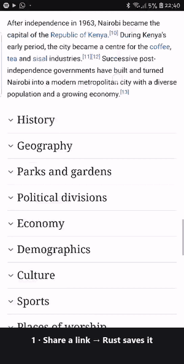

# Pocket Reader — Rivium + Apalis read-later app

Share a link from any Android app and Pocket Reader saves the article so you can read it later, **even offline**. The download, parsing and retrying happen in an embedded Rust worker (Rivium + Apalis), backed by SQLite.

<p align="center"></p>

<p align="center"><em>Recorded on a Samsung Galaxy S7 edge (Android 8.0), sped up 2–3×. Full quality: <a href="docs/demo.mp4">docs/demo.mp4</a>.</em></p>

Why a durable job queue fits this app:

- **You often share links with poor signal.** A failed download isn't lost. Apalis retries it with exponential backoff (5s → 2 min). If it still fails, the link is parked, and it's re-queued automatically when the phone gets a network connection again.
- **Android kills apps.** Jobs live in SQLite. If the app is swiped away or force-stopped mid-download, the job resumes on the next launch, and its attempt count carries on from where it was.
- **Dead links fail quickly.** A 404, a redirect loop or a malformed URL is marked as a permanent failure and isn't retried.

## Android features used

| Feature | What it does |
|---|---|
| **Share Sheet** (main feature) | *Share → Pocket Reader* from Chrome, YouTube, X, etc. The link is pulled out of whatever text the app shares, and tracking parameters (`utm_*`, `fbclid`, `si`, …) are removed. Sharing the same article twice stores it once. |
| **Notifications** | "*SQLite - Wikipedia* · Saved for offline · 15 min read", with a **Read now** action that opens the article. Videos (YouTube etc.) get "Saved to watch later · YouTube · channel · 0:32 video" with a **Watch now** action. Failures come with a **Retry** action. A quiet "Downloading 2 links…" notification is shown only while downloads are running. |
| **Quick Settings tile** | "Reading list · 3 unread" (or "1 failed · tap to retry"). Android 7–9 have no tile subtitles, so there the label itself shows "3 to read". Tapping it retries failed links and opens the list. |
| **Network callback** | When connectivity comes back, links that failed for network reasons are queued again. |

The app has a reading list (unread dots, status of each link: waiting, downloading, retrying (n of 6), or couldn't save + Retry) and an offline reader view of the extracted article text.

## Architecture

```
 Share sheet ─┐                         ┌──────── libpocket_backend.so (Rust) ─────────┐
 Tile ────────┼─► ReaderService ──JNI──►│ Rivium embedded host                         │
 In-app paste ┘   (foreground only      │  └─ "reader-worker" service                  │
                  while downloading)    │       Apalis worker, concurrency 3           │
                                        │       retry: exp. backoff, abort on 4xx      │
 Notifications ◄── ReaderHost pump ◄────│       job: fetch → extract article → save    │
 Reading list UI ◄─ list/open/counts ◄──│ SQLite pocket_reader.db                      │
                                        │  ├─ Jobs/Workers (apalis-sqlite queue)       │
                                        │  └─ articles (reading list + article text)   │
                                        └──────────────────────────────────────────────┘
```

- `src/lib.rs`: the Rivium `App`. It starts the Apalis worker. An SQLite update hook wakes the worker as soon as a job is inserted, and a 5s tick acts as a safety net.
- `src/job.rs`: the `SaveLink` job. It does an HTTP fetch (reqwest + rustls/ring + bundled webpki roots, so there are no platform TLS dependencies on Android), sorts errors into transient vs. permanent, and gives up after 6 attempts.
- `src/extract.rs`: finds the link in shared text, normalizes the URL, and does a small reader-mode extraction (title, site, author, description, body, reading time). Video pages (`og:type=video*` or a player card) are stored as videos with their duration instead of as empty articles. Unit tested.
- `src/db.rs`: reading-list schema and queries, including a durable "notified" flag, so an article that finishes just before a kill still gets its notification.
- `src/jni_bridge.rs`: the JNI functions used by `ReaderHost.kt`. They return JSON.

## 1. Run on a laptop (no phone needed)

```bash
cargo run -- --root target/laptop-data --set 'save=["https://en.wikipedia.org/wiki/SQLite", "Shared text with a link https://example.com/?utm_source=x"]'
```

The links are queued, downloaded and stored in `target/laptop-data/pocket_reader.db`. The logs show each step:

```
Queued https://en.wikipedia.org/wiki/SQLite
Fetching https://en.wikipedia.org/wiki/SQLite (attempt 1/6)
Saved "SQLite - Wikipedia" from en.wikipedia.org (3319 words, 15 min read)
```

Press `Ctrl+C` for a graceful shutdown. Run again without `--set` and any unfinished jobs resume. Logs are also written to `target/laptop-data/logs/`. Try an unreachable link (`https://127.0.0.1:9/x`) to watch retries and backoff, or a 404 to see it give up straight away.

Tests: `cargo test`

## 2. Build the Android library

```bash
rustup target add aarch64-linux-android x86_64-linux-android
cargo install cargo-ndk
cargo ndk -t arm64-v8a -t x86_64 -P 24 -o android/app/src/main/jniLibs build --release --lib
```

`-P 24` matches the app's `minSdk`. A library built against a newer API level can fail to load on older phones. Only the NDK is needed (no cmake/NASM), because TLS uses `ring` rather than `aws-lc-rs`.

## 3. Build and run the app

```bash
cd android
./gradlew assembleDebug
adb install -r app/build/outputs/apk/debug/app-debug.apk
adb shell am start -n dev.apalis.riviumchallenge/.MainActivity
```

Simulate a share from another app:

```bash
adb shell am start -a android.intent.action.SEND -t text/plain \
  --es android.intent.extra.TEXT "'Great read https://en.wikipedia.org/wiki/SQLite?utm_source=share'" \
  -n dev.apalis.riviumchallenge/.ShareActivity
```

Rust logs appear in logcat under the tag `pocket-backend` (`adb logcat -s pocket-backend`).

## 4. Durability checks

| Scenario | Expected |
|---|---|
| Share, then `adb shell am force-stop dev.apalis.riviumchallenge` mid-download, then reopen | The job is re-queued at startup and its attempt count continues (e.g. `attempt 2/6`) |
| Share with networking off (`adb shell cmd connectivity airplane-mode enable`) | Shows "no connection, retrying (attempt n of 6)", then "couldn't save" with a Retry button |
| Turn networking back on | The failed link is re-queued automatically and saved |
| Share the same article twice (with different `utm_` tags) | One entry: "Already in your reading list" |

## What was tested

- **Laptop (Windows 11, Rust 1.99.1):** saving real pages; shared-text link extraction; 404 gives up after one attempt; an unreachable host retries with backoff and is parked after 6 attempts; killing the process mid-retry and restarting immediately resumes the job; duplicates collapse into one entry.
- **Android emulator (API 36, x86_64):**
  - Share-sheet intent → article saved in about 4.5 seconds → notification "SQLite - Wikipedia · Saved for offline · 15 min read" → foreground service stops itself. The reading list shows the unread article, and opening from a notification intent shows the reader view.
  - Airplane mode → share → attempts 1–2 fail with "no connection" → `am force-stop` → network back on → reopen → resumes at **attempt 3/6** and saves.
  - Airplane mode → share → all 6 attempts fail → "Couldn't save · no connection" notification with Retry → network back on with the app untouched → the network callback re-queues it → saved.
- **Real phone: Samsung Galaxy S7 edge (SM-G935F), Android 8.0 / API 26, arm64.** Everything below is from logcat (`pocket-backend`) and the recording above.
  - **Startup:** the Rivium host goes from `starting` to `running` in 40–110 ms, including opening SQLite and migrating the schema of an existing database.
  - **Share sheet:** Chrome → Pocket Reader. Wikipedia "Nairobi" (13,620 words) was saved in 1.75 s, a BBC Sport article in a few seconds, and the notification and Read now worked.
  - **YouTube Shorts:** the first try saved a Short as an *empty article*. YouTube had served an "unsupported browser" page to our custom user agent, and the extractor had no idea of videos. After the fix, Shorts save in 4–8 s as `video "…" from YouTube (31s)` with channel and duration, and the notification shows "Saved to watch later".
  - **Offline + force stop:** airplane mode → share → attempts 1/6, 2/6 and 3/6 failed with "no connection", with backoff gaps of about 6 s and 11 s → Settings → Force stop → airplane mode off → reopen. The new process was ready 90 ms after launch, ran **attempt 4/6** (the count came from SQLite), and saved the article 1 s after the app opened.
  - **Quick Settings tile:** showed only "Reading list" with no count, because `Tile.subtitle` only exists on Android 10+. Fixed by putting the count in the label on older versions ("2 to read").
  - **Notes for Rivium:** the embedded host, `rivium-jni` export and logcat sink all worked on API 26 with a library built with `cargo ndk -P 24`. Nothing Rivium-specific failed on the real device. (The first install failed only because the phone's storage was full; trimming caches fixed it.)

## Bugs found and fixed in the original version

- **Jobs waited up to 30s before running.** A plain `SqliteStorage` parks when the queue is empty and was only woken by the 30s heartbeat. Fixed with `connect_with_callback` + `poll_with_stream`.
- **Restarting soon after a kill crashed the worker** (`WORKER_ALREADY_EXISTS`). Apalis rejects a worker name seen within the last heartbeat. Rivium's lock on the data root guarantees a single host, so the leftover row is now expired at startup. This also re-queues the killed run's jobs straight away.
- **A boxed `AbortError` was still retried.** Apalis's built-in check downcasts the `Box`, not its contents. Fixed with `retry_if`.
- **Found on the real phone:** YouTube served an "unsupported browser" page to the app's old custom user agent (it now sends a mobile Chrome user agent); videos were saved as "1 min read" articles with no text; the tile count was invisible on Android < 10.
- **Extraction:** Wikipedia's table of contents leaked into the article body; links ending in `)` (e.g. `Rust_(programming_language)`) were cut short.
- **`INTERNET` permission was missing; shares sent during startup were dropped silently; the "running" badge used the wrong status codes; README commands used the wrong application ID.**

## Pinned versions

**Rust** (1.92+ required by Rivium; tested with 1.99.1): `rivium` 0.2.0, `rivium-host` 0.2.0, `rivium-jni` 0.2.0, `apalis` 1.0.0, `apalis-core` 1.0.0, `apalis-sqlite` 1.0.0, `sqlx` 0.9.0, `tokio` 1.54, `reqwest` 0.13.5 (`rustls-no-provider`), `rustls` 0.23 (`ring`), `webpki-roots` 1.0, `scraper` 0.29, `url` 2. Exact versions are in `Cargo.lock`.

**Android:** Gradle 9.1.0, AGP 9.0.1, Kotlin 2.3.20, Compose BOM 2026.03.01, Navigation3 1.0.1, compile/target SDK 36, min SDK 24, NDK 27.2.12479018, JDK 21, cargo-ndk 4.1.2.

## Limitations

- Extraction is heuristic (paragraphs inside `article`/`main`). Pages that render with JavaScript only, or sit behind a paywall, are saved with title and description but little body text. "Open original" is always available.
- Pages over 4 MB are truncated. Non-HTML links (PDFs, images) are saved as link-only entries.
- Downloads keep running while the app process is alive. If Android kills the process during a long offline period, the queue resumes the next time the app, share sheet or tile is used.
