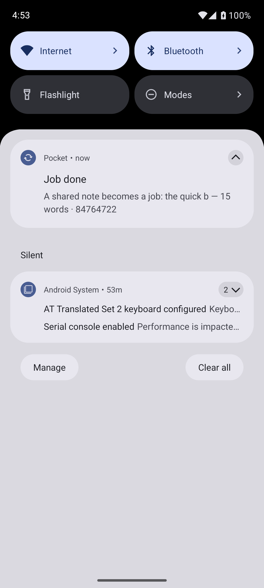

# Pocket

A tiny durable job queue that runs **inside an Android app**. Share text from any
app and a Rust worker — supervised by [Rivium](https://github.com/rivium-rs/rivium),
queued by [Apalis](https://github.com/apalis-dev/apalis) — describes it, then reports
back through a notification.

The same `App` runs on a laptop with `cargo run` and inside the phone. Nothing in the
queue code knows which host it is under.

The original challenge brief is preserved as [CHALLENGE.md](CHALLENGE.md).

## What it does

Share a snippet from Chrome, a note, anywhere:

```
Share → Pocket  →  POST 127.0.0.1:8787/jobs  →  SQLite  →  worker  →  notification
```

The job is written to disk **before** any work starts, so closing the app, or the
system killing it, loses nothing. Reopen and the work finishes.

One job type: count the characters and words, find the distinct words, and take an
FNV-1a hash so the same text always gives the same fingerprint.


Note the `done · attempt 2` entry — that job was killed mid-flight and recovered by
the next launch. When it finishes, the result arrives as a notification:



A short recording of the flow is in [`docs/share.gif`](docs/share.gif).

## How it works

- **Rivium** owns the lifecycle. `src/app.rs` implements `App` and returns two
  supervised services: the HTTP listener on the `Frontline` tier and the worker on
  `Background`. Shutdown therefore stops accepting requests first, then drains the
  job in flight. Readiness is also the migration barrier: the worker service reports
  ready only after migrations and the `job_view` table exist, and the listener cannot
  serve until every service is ready.
- **Apalis** owns the queue. `apalis-sqlite` gives retries, scheduled jobs and orphan
  recovery. Two settings matter and both are in `src/queue.rs`: a **unique worker name
  per run**, and a **1.5 s heartbeat**. With a fixed name, apalis refuses to register
  the new worker (`WORKER_ALREADY_EXISTS`) and the dead run's job stays `running`
  forever.
- **The share sheet** is the Android feature. It posts to a loopback listener, because
  Rivium's JNI bridge deliberately exposes only start/stop/status/version — there is no
  "enqueue" call, and adding one would mean undocumented `unsafe` JNI. HTTP is also the
  reason the laptop path and the phone path are identical.

`job_view` is the app's own read model. The UI never reads Apalis's internal tables.

## Run it on a laptop

No phone needed.

```sh
cargo run -- --root target/pocket
```

```sh
curl -s localhost:8787/readyz                     # 200 once the queue is migrated
curl -s -X POST localhost:8787/jobs \
  -H 'content-type: application/json' \
  -d '{"text":"the quick brown fox jumps over the lazy dog"}'
curl -s localhost:8787/jobs/<id>
```

Real output:

```
POST /jobs -> {"id":"01M5YT2EEDAV70HZJF6FH32G3C"}
done after ~1300ms
{"id":"01M5YT2EEDAV70HZJF6FH32G3C","text":"the quick brown fox over the lazy dog",
 "status":"done","attempts":1,
 "result":{"chars":43,"elapsed_ms":0,"hash":"7404cea13ff89bb0","unique_words":8,"words":9}}
```

`work_ms` is a debug knob that makes a job slow on purpose — useful for the tests
below. `--set lifecycle.stop_timeout=10s` raises the 3 s default shutdown grace;
without it, a job longer than 3 s is cut off instead of allowed to finish.

Ctrl-C with a 4 s job running:

```
state before signal:  ('running', 1)
process exit code:    0
state after shutdown: ('done', 1)
residue:              none
```

## Run it on a phone

Requires Rust 1.92+, JDK 21, Android SDK platform 36 and **NDK 28.1.13356709**, plus
`cargo-ndk 4.1.2`.

```sh
android/build-rust.sh          # cross-compiles libpocket.so for arm64-v8a and x86_64
cd android && ./gradlew installDebug
```

Open the app once so the host starts, then share text from any other app. The first
share works too: it retries until the host is ready, because a share can launch the
process before Rivium has finished starting.

```sh
adb forward tcp:8787 tcp:8787  # optional: poke the phone's queue from the laptop
curl -s localhost:8787/readyz
```

## What survives what

| Situation | Result |
| --- | --- |
| App closed normally | Job stays on disk, finishes on next launch |
| `am force-stop` mid-job | Row stays `running`; next launch reclaims it, `attempts` → 2 |
| Process killed mid-job | Same — the row is on disk, not in memory |
| Job fails | Retried up to 5 attempts with backoff |
| Shutdown with a job running | Listener stops, worker drains, exit code 0 |

Measured on the emulator:

```
enqueue 6 s job → before force-stop: running|1
app process count: 0                                  (dead)
on disk while app is dead: running|1                  (survived)
relaunch → recovered after ~8.5s → done|2
```

## Versions

Pinned exactly; `Cargo.lock` is committed.

| Component | Version |
| --- | --- |
| `rivium`, `rivium-host`, `rivium-http`, `rivium-jni` | 0.2.0 |
| `apalis`, `apalis-sqlite` | 1.0.0 |
| `sqlx` (sqlite, bundled) | 0.9.0 |
| Rust / Cargo | 1.99.1 (MSRV 1.92) |
| Android NDK | 28.1.13356709 |
| cargo-ndk | 4.1.2 |
| JDK / Gradle / AGP | 21.0.13 / 9.8.2 / 9.4.1 |
| minSdk / compileSdk | 30 / 36 |
| ABIs | `arm64-v8a`, `x86_64` |

## Known limits

- **Tested on an x86_64 emulator (API 36), not a physical phone.** The `arm64-v8a`
  library is built and verified (ELF64 AArch64, every `LOAD` aligned to 16 KB, exactly
  one `JNI_OnLoad`), but it has not been run on arm64 hardware.
- Delivery is **at-least-once**. The handler is idempotent, so a retry overwrites the
  same row rather than duplicating results.
- `apalis-sqlite` sets `PRAGMA synchronous = OFF`. Jobs survive process death, but not
  necessarily sudden power loss. That is a deliberate trade in the library, not a
  choice made here.
- The listener is **loopback only** and unauthenticated; it is not reachable from
  another device.
- No foreground service: the app is allowed to die, which is exactly the behaviour the
  persistence story depends on.
- One job type, by design.

## Layout

```
src/app.rs      App impl: two supervised services, the shared database handle
src/queue.rs    SQLite storage, migrations, job_view, unique worker names
src/job.rs      the job, its result, and the Apalis handler
src/http.rs     POST /jobs, GET /jobs, GET /jobs/{id}
src/main.rs     laptop entry point (process host)
src/lib.rs      JNI export for Android (embedded host)
android/        Kotlin app: share sheet, notification, job list
```
