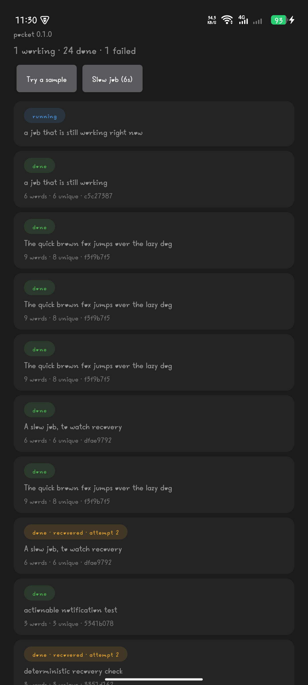
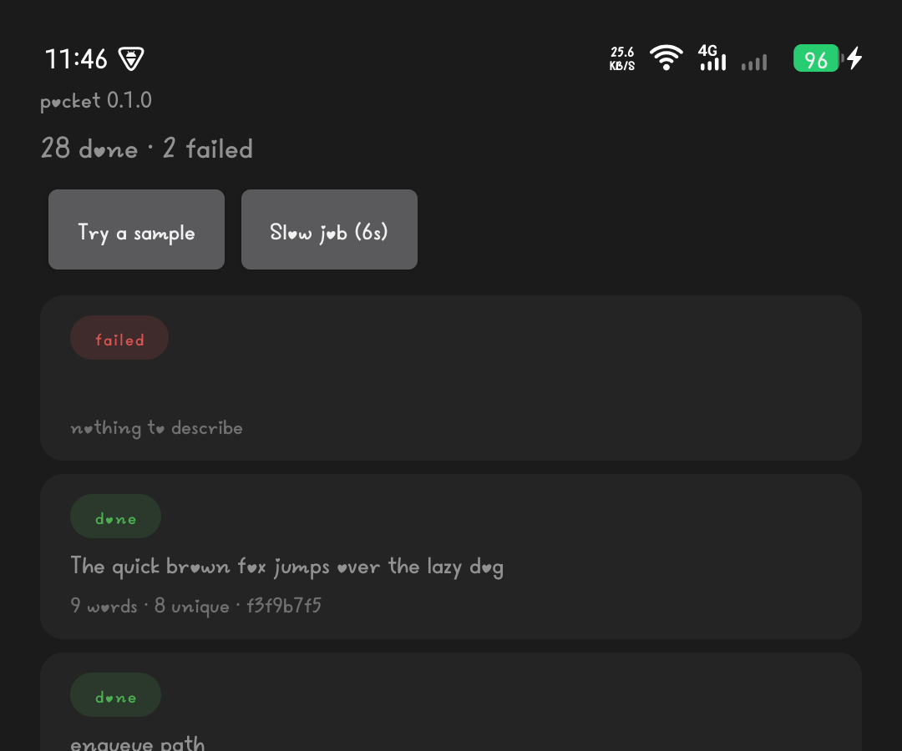
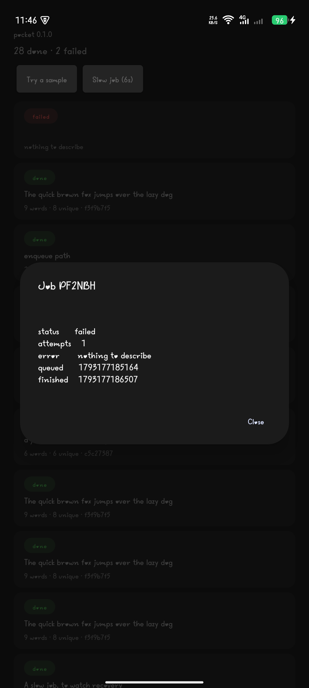

# Pocket

A tiny durable job queue that runs **inside an Android app**. Share text from any
app and a Rust worker — supervised by [Rivium](https://github.com/rivium-rs/rivium),
queued by [Apalis](https://github.com/apalis-dev/apalis) — describes it, then reports
back through a notification.

The same `App` runs on a laptop with `cargo run` and inside the phone. Nothing in the
queue code knows which host it is under.

The original challenge brief is preserved as [CHALLENGE.md](CHALLENGE.md).

## What it does

Share a snippet from Chrome, a note, anywhere:

```text
Share → Pocket  →  POST 127.0.0.1:8787/jobs  →  SQLite  →  worker  →  notification
```

The job is written to disk **before** any work starts, so closing the app, or the
system killing it, loses nothing. Reopen and the work finishes.

One job type: count the characters and words, find the distinct words, and take an
FNV-1a hash so the same text always gives the same fingerprint.

Four states, all captured on the phone. Empty, and working:




Once jobs exist, the list distinguishes them at a glance — `done`, an amber
`recovered · attempt 2`, and a red `failed`:


A job that cannot succeed is not left pretending to run — it records why:



Tapping any row opens the full result, with the attempt count and the hash in monospace:



A finished job arrives as a notification carrying **Copy hash** and **Share result**:


[`docs/share.gif`](docs/share.gif) is one continuous recording on the phone. In order: the
app open, the Android share sheet with Pocket in it, the share arriving as a job, that
result appearing as a heads-up notification, **Slow job (6s)** started, the process
force-stopped while it was in flight, and after reopening the same job back at the top of
the list as `done · recovered · attempt 2`.

## What survives what

| Situation | Result |
| --- | --- |
| App closed normally | Job stays on disk, finishes on next launch |
| `am force-stop` mid-job | Row stays `running`; next launch reclaims it, `attempts` → 2 |
| Process killed mid-job | Same — the row is on disk, not in memory |
| Job fails | Retried up to 5 attempts with backoff; the row says `failed` and why |
| Job cannot succeed (empty text) | Recorded as `failed` immediately, not retried pointlessly |
| Shutdown with a job running | Listener stops, worker drains, exit code 0 |


## What happens if I kill it

The claim is that nothing is lost. Three commands show it on a phone:

```sh
adb forward tcp:8787 tcp:8787
ID=$(curl -s -X POST localhost:8787/jobs -H 'content-type: application/json' \
  -d '{"text":"kill me mid job","work_ms":8000}' | python3 -c 'import json,sys;print(json.load(sys.stdin)["id"])')
curl -s localhost:8787/jobs/$ID          # wait for "status":"running"
adb shell am force-stop dev.kouragita.pocket
adb shell am start -n dev.kouragita.pocket/.MainActivity
curl -s localhost:8787/jobs/$ID          # now "done", "attempts":2
```

What that produced on the phone:

```text
claimed after ~900ms:   running | attempts 1
force-stop → process gone; row pulled from the device database: running|1
relaunch → recovered after 9s → done | attempts 2
```

In the app the same job renders as `done · recovered · attempt 2`. That line is the
whole point: it exists because a worker died and the queue kept the promise, and no
ordinary to-do app can show it.

## When a job cannot succeed

The failure path is recorded rather than assumed. With the single worker busy on a slow
job, submit text that is only whitespace:

```text
before   pending | attempts 0 | result None
after    failed  | attempts 1 | result {"error":"nothing to describe"}
```

It is not retried, because retrying cannot turn whitespace into something to describe,
and the row says so instead of sitting at `running` forever.

## On a real phone

Tested on a TECNO KM7k running Android 15 (API 35), arm64-v8a. Rivium's own Android
lane only compiles the library and inspects its ELF properties, so these are device
observations rather than a repeat of CI.

- The APK ships `arm64-v8a` and `x86_64`; the phone installed **only** `arm64`
  (`primaryCpuAbi=arm64-v8a`, `secondaryCpuAbi=null`), so the arm64 build is the one that
  actually ran.
- The host was ready about **1 s** after launch, and a shared note finished in about
  **0.5 s**.
- `am force-stop` during a 6 s job left the row `running` on disk. Relaunching reclaimed
  it after about **4.5 s** and finished with `attempts = 2`.
- The first cold start showed an empty list even though the queue had jobs: the list was
  fetched before the listener existed and never retried. Fixed by refreshing when the host
  reports ready and again in `onResume`. The emulator hid this because every test there
  began with a share.
- This phone's software build has no `sqlite3` binary, unlike the emulator image, so
  reading the database meant copying it off the device with `run-as ... cat` and querying
  it locally.

## Versions

Pinned exactly; `Cargo.lock` is committed.

| Component | Version |
| --- | --- |
| `rivium`, `rivium-host`, `rivium-http`, `rivium-jni` | 0.2.0 |
| `apalis`, `apalis-sqlite` | 1.0.0 |
| `sqlx` (sqlite, bundled) | 0.9.0 |
| Rust / Cargo | 1.99.1 (MSRV 1.92) |
| Android NDK | 28.1.13356709 |
| cargo-ndk | 4.1.2 |
| JDK / Gradle / AGP | 21.0.13 / 9.8.2 / 9.4.1 |
| minSdk / compileSdk | 30 / 36 |
| ABIs | `arm64-v8a`, `x86_64` |

## Known limits

- Tested on one physical phone (TECNO KM7k, Android 15, arm64-v8a) and one x86_64
  emulator (API 36). Nothing else was tried.
- Delivery is **at-least-once**. The handler is idempotent, so a retry overwrites the
  same row rather than duplicating results.
- `apalis-sqlite` sets `PRAGMA synchronous = OFF`. Jobs survive process death, but not
  necessarily sudden power loss. That is a deliberate trade in the library, not a
  choice made here.
- The listener is **loopback only** and unauthenticated; it is not reachable from
  another device.
- No foreground service: the app is allowed to die, which is exactly the behaviour the
  persistence story depends on.
- The notification carries **Copy hash** and **Share result**. Copy hash was tapped on the
  phone and the receiver logged `copied hash f3f9b7f5e7e47110` — the full sixteen
  characters. Share result is attached and visible in the notification, but its tap was
  not captured.
- One job type, by design.

## Layout

```text
src/app.rs      App impl: two supervised services, the shared database handle
src/queue.rs    SQLite storage, migrations, job_view, unique worker names
src/job.rs      the job, its result, and the Apalis handler
src/http.rs     POST /jobs, GET /jobs, GET /jobs/{id}
src/main.rs     laptop entry point (process host)
src/lib.rs      JNI export for Android (embedded host)
android/        Kotlin app: share sheet, notification, job list
```

## Contact

Questions, corrections or review comments: [@kouragitamaster](https://x.com/kouragitamaster)
on X.
