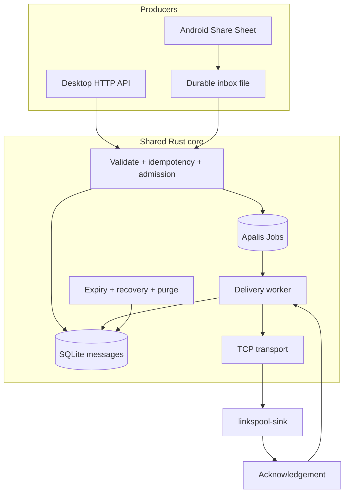

# LinkSpool

**Store-and-forward over TCP for data that must arrive, with delivery you can audit.**

LinkSpool is a durable transport. A producer hands it a unit of data, LinkSpool writes it to SQLite, sends it to a receiver over a TCP connection when the link allows, and keeps it until the receiver confirms it has stored it:

```text
producer --> SQLite (persist first) --> TCP frame [4-byte length | JSON] --> linkspool-sink
                  ^                                                              |
                  +---------- retry with backoff until "stored" ack <-----------+
```

The units it carries are things that cannot be allowed to vanish just because a network did: an alarm from a field device, a sensor reading, an incident report, evidence captured on a phone. In this README, a **packet** means one such application-level unit of data with an identity, a deadline and a delivery obligation. It is not an IP or TCP packet; each LinkSpool packet travels as one length-prefixed frame on a TCP stream.

A phone is the worst place to send packets from. The network drops, the OS kills background work, and the app gets closed mid-send. LinkSpool treats that as the normal case, and every packet ends in a recorded state (`delivered`, `expired` or `dead_lettered`), never in silence.

The same Rust core runs as a desktop daemon and inside an Android app. On Android the phone is the packet source: today it accepts text and URLs through the system **Share Sheet**, wraps each in a packet envelope, and a foreground service keeps delivery running after the UI is closed.

> Accept locally. Persist first. Account for every packet.

### Packets, not chat messages

LinkSpool never interprets what a packet contains. It only guarantees what happens to it, over TCP, until the receiver says it has stored it:

| Question | What LinkSpool does |
|---|---|
| Can an accepted packet be lost? | No. It is committed to SQLite, together with its delivery job, before the producer is told it was accepted. |
| Can it be silently dropped when the queue is full? | No. Admission is bounded, and a full queue rejects the new packet explicitly. |
| Does "sent" mean "received"? | No. A packet counts as delivered only when the receiver acknowledges that it has stored it. |
| What if the acknowledgement is lost? | The packet is retransmitted, and the receiver recognises the repeat by packet ID. |
| What if a packet is too old to matter? | It expires instead of being transmitted late. |
| What if delivery keeps failing? | It becomes a visible dead letter, not a disappearance. |

The payload today is JSON. Share Sheet text is the simplest packet, but the transport does not depend on its meaning.

> A note on naming: the code, HTTP API and database still call these records `messages`. The "packet" framing describes the delivery model, not a rename of the API.

## Why this is more than a queue

A job queue answers "will this task run again if it fails?". LinkSpool answers a different question: **"did my data actually arrive, and can I show it?"**

- **A real wire protocol, with a real receiver.** Four-byte length-prefixed JSON frames and explicit `accepted` / `duplicate` / `rejected` acknowledgements. An acknowledgement means the receiver has *stored* the message, not just read the socket. `linkspool-sink` is the other half, so the sender and receiver can be checked against each other.
- **At-least-once delivery you can watch happen.** `linkspool-sink --drop-ack` stores a message but drops the acknowledgement. LinkSpool retries, the sink recognises the duplicate, and it reports `received=1 duplicates=1`. The failure is injected, visible and absorbed.
- **No silent loss by construction.** Acceptance happens only after the message and its first delivery job commit in one SQLite transaction. Capacity limits reject new work explicitly instead of dropping accepted work.
- **Built for the phone's failure modes.** The Share Sheet hand-off is written to a durable inbox file before the service starts, so a slow or failed start cannot lose what the user shared.

## What it demonstrates

This is a submission for the [Rivium + Apalis challenge](https://github.com/apalis-dev/rivium-challenge). It connects all three required pieces:

- **Rivium** supervises the HTTP API, delivery worker, maintenance sweep, inbox and status services on desktop and Android.
- **Apalis** owns durable execution of delivery jobs in SQLite. One job type is enough: deliver message `M`, attempt `N`.
- **Android Share Sheet** is the producer feature. Shared text or a URL becomes a packet: it is written to a durable inbox and delivered by the embedded host.

The desktop build needs no phone. The Android build uses the same core through JNI.

## What you can audit today

| Question | Where the answer is |
|---|---|
| Did the sender accept it? | The producer gets `201` only after commit; the message row exists with a ULID |
| What happened to it? | `state` and `last_error` on the message, plus attempt counts (`GET /v1/messages/{id}` on desktop, `status.json` on Android) |
| Did the receiver store it? | The sink's `received` count, and the acknowledgement the sender recorded |
| Was anything delivered twice? | The sink's `duplicates` count; duplicates are acknowledged but not re-applied |
| Did anything get stuck? | Maintenance recovers stale `delivering` rows; `dead_lettered` messages are kept for inspection until retried or discarded |

Comparing the sender's `delivered` count with the sink's `received` count is the current reconciliation check. It is manual.

### Planned, not built

These would turn the reconciliation above from a manual comparison into a proof. They are not implemented, and nothing in this README relies on them:

- A per-producer sequence number in the envelope, so the sink can detect **gaps** and print a final audit (sent, received, duplicates suppressed, gaps).
- More sink fault injection (random connection drops and delays) beyond `--drop-ack`.
- A connectivity-driven trigger (`ConnectivityManager.NetworkCallback`) so the queue drains the moment the network returns, with live queue depth in the notification.

## Features

- Desktop loopback HTTP API (Axum) with submit, list, fetch, retry and discard.
- Android Share Sheet target for `text/plain`.
- SQLite message store as the single authoritative record.
- Producer-scoped idempotency keys.
- Bounded admission by message count, queued bytes and payload size.
- Message expiry.
- Exponential retry with a configurable attempt limit.
- Dead-letter inspection, explicit retry and discard.
- Durable Apalis jobs written in the same transaction as the message.
- Raw TCP transport with four-byte big-endian length-prefixed JSON frames.
- Explicit receiver acknowledgements (`accepted`, `duplicate`, `rejected`).
- `linkspool-sink` companion receiver with SQLite deduplication and `--drop-ack`.
- Stale-delivery recovery after a worker or process disappears.
- Periodic status snapshot for the Android UI.
- Foreground service so delivery continues while the UI is closed.

## Versions

| Component | Version |
|---|---|
| Rust | 1.94.0 (pinned by `rust-toolchain.toml`) |
| Rivium / `rivium-host` / `rivium-jni` | 0.2.0 |
| Apalis / `apalis-sqlite` | 1.0.0 |
| Axum | 0.8.9 |
| SQLx | 0.9 |
| Tokio | 1.54 |
| Android Gradle Plugin | 8.9.1 |
| Kotlin | 2.1.20 |
| Gradle | 8.13 |
| Android compile/target SDK | 35 |
| Android min SDK | 26 |
| Android NDK | 27.x |

## Architecture



Message ingestion and job creation commit in one SQLite transaction. A job contains only a message identifier and an attempt number; the payload stays in the message row. The worker re-reads the authoritative state before transmitting, so duplicate or stale jobs are safe.

## Repository layout

```text
linkspool/
├── Cargo.toml                  workspace
├── Cargo.lock
├── rust-toolchain.toml         Rust 1.94.0
├── linkspool.toml              desktop configuration
├── build.sh                    Android APK build
├── migrations/0001_init.sql    message table
├── src/
│   ├── main.rs                 desktop entry point
│   ├── lib.rs
│   ├── app.rs                  Rivium App composition
│   ├── api.rs                  Axum router and error mapping
│   ├── delivery.rs             Apalis worker service
│   ├── inbox.rs                file-drop ingestion
│   ├── maintenance.rs          expiry, recovery, purge
│   └── status.rs               JSON snapshot for Android
├── tests/
│   ├── api.rs                  HTTP contract tests
│   └── end_to_end.rs           core + sink over real TCP
├── crates/
│   ├── linkspool-core/
│   │   ├── src/{config,core,error,jobs,message,persistence,transport}.rs
│   │   └── tests/lifecycle.rs  ingestion, admission, retry, recovery
│   ├── linkspool-protocol/     frames, envelopes, acknowledgements
│   ├── linkspool-sink/         companion receiver
│   └── linkspool-jni/          five-method Android bridge
└── android/
    ├── settings.gradle.kts
    ├── build.gradle.kts
    └── app/src/main/
        ├── AndroidManifest.xml
        ├── java/dev/linkspool/app/
        │   ├── NativeHost.java
        │   ├── HostController.kt
        │   ├── HostService.kt
        │   ├── Inbox.kt
        │   ├── MainActivity.kt
        │   ├── Settings.kt
        │   └── ShareActivity.kt
        └── res/
```

## Desktop quick start

Prerequisites: Rust 1.94.0 via `rustup`, Cargo, and a C toolchain for the bundled SQLite build.

Terminal 1 — start the receiver:

```bash
cd linkspool
cargo run -p linkspool-sink -- --database /tmp/linkspool-sink.db
```

Terminal 2 — start LinkSpool:

```bash
cd linkspool
cargo run
```

`cargo run` defaults `--root` to the current directory, so `linkspool/linkspool.toml`, the database, inbox, status file and logs all live under `linkspool/`.

Submit a message:

```bash
curl -sS -X POST http://127.0.0.1:8080/v1/messages \
  -H 'Content-Type: application/json' \
  -d '{
    "idempotency_key": "event-001",
    "payload": { "event": "device_status", "status": "online" }
  }'
```

The response is `201 Created` only after the message and its first Apalis job are durable. Repeating the same producer and key returns `200 OK` with the existing message and `"duplicate": true`.

Inspect state:

```bash
curl -sS 'http://127.0.0.1:8080/v1/messages?limit=5'
curl -sS 'http://127.0.0.1:8080/v1/messages?state=dead_lettered'
```

Other endpoints:

| Method | Path | Purpose |
|---|---|---|
| `GET` | `/health` | Liveness |
| `POST` | `/v1/messages` | Submit a message |
| `GET` | `/v1/messages` | List messages (`state`, `limit`) |
| `GET` | `/v1/messages/{id}` | Fetch one message |
| `POST` | `/v1/messages/{id}/retry` | Retry a dead-lettered message |
| `DELETE` | `/v1/messages/{id}` | Discard a dead-lettered or expired message |

The API binds to `127.0.0.1:8080` by default. It is disabled in the Android profile.

### Desktop configuration

`linkspool/linkspool.toml` contains the defaults. Relative paths resolve against `--root`.

```toml
[api]
enabled = true
listen = "127.0.0.1:8080"

[database]
path = "linkspool.db"

[queue]
destination = "local-sink"
max_payload_bytes = 262144
max_queued_bytes = 67108864
max_queued_messages = 10000
max_attempts = 8
retry_base_ms = 1000
retry_cap_ms = 60000

[transport]
sink_addr = "127.0.0.1:9000"
connect_timeout_ms = 3000
ack_timeout_ms = 5000
max_frame_bytes = 1048576

[maintenance]
interval_ms = 30000
terminal_retention_hours = 168
stale_delivery_ms = 300000
```

Runtime data:

- Database: `linkspool/linkspool.db`
- Logs: `linkspool/logs/linkspool/linkspool.log`
- Inbox (Android profile): `linkspool/inbox/`
- Status snapshot (Android profile): `linkspool/status.json`

## Android

### Build the APK

```bash
bash linkspool/build.sh
```

The script:

1. Finds the Android SDK and NDK (or uses `ANDROID_HOME` / `ANDROID_NDK_HOME`).
2. Installs the `aarch64-linux-android` and `x86_64-linux-android` Rust targets when missing.
3. Cross-compiles `linkspool-jni` with the NDK clang linker and the bundled SQLite amalgamation.
4. Copies `liblinkspool_jni.so` and `libc++_shared.so` into `jniLibs/`.
5. Downloads a pinned Gradle 8.13 distribution if needed.
6. Assembles the debug APK and writes `linkspool/debug.apk`.

Install it:

```bash
adb install -r linkspool/debug.apk
```

### Run it

Start the sink on the laptop:

```bash
cd linkspool
cargo run -p linkspool-sink -- \
  --listen 127.0.0.1:9000 \
  --database /tmp/linkspool-sink.db
```

Then point the app at it. On a phone, `127.0.0.1` is the phone itself, so the app cannot reach a laptop sink by default. Pick one route:

| Where the app runs | Sink address in the app | Setup |
|---|---|---|
| **Real phone over USB (recommended)** | `127.0.0.1:9000` | `adb reverse tcp:9000 tcp:9000` |
| Real phone over Wi-Fi | `<laptop-LAN-IP>:9000` | Start the sink with `--listen 0.0.0.0:9000`, allow port 9000 in the firewall, and keep both devices on a network that does not isolate clients |
| Emulator | `10.0.2.2:9000` (the default) | None |

For the USB route:

```bash
adb reverse tcp:9000 tcp:9000
adb reverse --list          # expect: tcp:9000 tcp:9000
```

The reverse tunnel is dropped when the cable is unplugged or `adb` restarts, so re-run it if deliveries start failing with connection errors. Enter the address in the app and press **Start**.

### Share Sheet demo

1. Open Chrome (or any app with selectable text).
2. Select a link or paragraph and choose **Share**.
3. Pick **LinkSpool**.
4. LinkSpool writes the text to a durable inbox file, starts the foreground host, and shows `Queued for delivery`.
5. Open the LinkSpool app to see queued, delivered and dead-lettered counts.
6. Close the UI. The foreground service keeps the host running; the notification shows that delivery is active.
7. Reopen the app: counts come from `status.json`, and unfinished messages resume from SQLite.

You can also type or paste text into the compose field and press **Queue message**.

### Android storage

All state is application-private:

- `filesDir/linkspool.db` — authoritative messages and Apalis jobs
- `filesDir/inbox/` — durable share hand-off
- `filesDir/status.json` — counts for the UI
- `filesDir/logs/linkspool/linkspool.log` — host log

Inspect with:

```bash
adb shell run-as dev.linkspool.app ls -R files
adb shell run-as dev.linkspool.app cat files/status.json
```

### Why a file inbox instead of a second JNI method?

`rivium-jni` exposes a fixed five-method ABI and the workspace forbids `unsafe_code`. Adding a bespoke native submission method would mean hand-written JNI declarations outside that ABI. Instead, Android writes a complete file to `filesDir/inbox/` using a temporary name and an atomic rename, then starts the embedded host. The inbox service ingests the file and deletes it only after the message is durable. The file stem is the idempotency key, so a crash between ingestion and deletion produces the same message rather than a duplicate.

The embedded arguments disable the HTTP API:

```text
--root <filesDir>
--set api.enabled=false
--set inbox.enabled=true
--set status.enabled=true
--set transport.sink_addr=<host:port>
```

## Reliability semantics

### Persist before acknowledging

`Core::submit` validates the payload, idempotency key, destination and expiry, then opens `BEGIN IMMEDIATE`. It inserts the message and calls `apalis_sqlite::queries::push_tasks` for the first delivery job in the same transaction. The producer receives `201` only after commit.

### Idempotency

A unique partial index on `(producer, idempotency_key)` scopes keys to the producer. A repeat returns the existing message with `duplicate: true`; it does not create another row or another job.

### Bounded admission

A submission is rejected with `QueueFull` when it would exceed `max_queued_messages` or `max_queued_bytes`. Capacity is occupied by `pending`, `delivering`, `retry_scheduled` and `dead_lettered`. Delivered, expired and discarded rows release capacity. Dead letters are retained for inspection for `terminal_retention_hours` and then purged by maintenance.

### Expiry

`expires_at` must be in the future at submission. Maintenance moves due messages to `expired`; a worker that claims a message just past its deadline expires it instead of transmitting.

### Retry and dead-lettering

A transient transport failure schedules attempt `N + 1` with exponential backoff:

```text
delay = min(retry_base_ms * 2^(attempt - 1), retry_cap_ms)
```

The retry state update and the next Apalis job commit together. When `attempts >= max_attempts`, or the receiver returns `rejected`, the message becomes `dead_lettered`. `POST /v1/messages/{id}/retry` re-enqueues it with an extended budget; `DELETE` discards it.

### Recovery

A claim increments `attempts` and sets `delivering` before transmission. If the worker or process disappears, maintenance finds `delivering` rows older than `stale_delivery_ms`, rewinds the attempt, sets `retry_scheduled`, and pushes a recovery job. This keeps the message row and the Apalis job consistent.

The delivery worker uses a unique per-process Apalis worker name (`linkspool-delivery-<pid>`) so a quick restart cannot collide with the previous worker registration. The queue polls every 500 ms.

### At-least-once delivery

LinkSpool does not claim exactly-once delivery. If the receiver persists a message but the acknowledgement is lost, LinkSpool retries. The sink deduplicates by `message_id`, increments `duplicate_count`, and acknowledges the duplicate without repeating its application-side effect.

## Lost-acknowledgement demo

This is the most interesting failure mode and is covered by `tests/end_to_end.rs`.

1. Start the sink with `--drop-ack`:

   ```bash
   cargo run -p linkspool-sink -- \
     --database /tmp/linkspool-sink.db \
     --drop-ack
   ```

2. Submit a message:

   ```bash
   curl -sS -X POST http://127.0.0.1:8080/v1/messages \
     -H 'Content-Type: application/json' \
     -d '{"idempotency_key":"lost-ack","payload":{"event":"lost_ack"}}'
   ```

3. The first attempt records the message in the sink but drops the acknowledgement. After the 5 s ack timeout LinkSpool schedules a retry. The message state is `retry_scheduled` with a timeout error.

4. The retry reaches the sink as a duplicate. The sink acknowledges it, and LinkSpool marks the message `delivered` on attempt 2.

5. Confirm on the sink: `received=1`, `duplicates=1`.

The same script without `--drop-ack` demonstrates the ordinary path: one attempt, `received=1`, `duplicates=0`.

## Tests

```bash
cd linkspool
cargo fmt --all --check
cargo clippy --workspace --all-targets
cargo test --workspace
```

Coverage:

- `crates/linkspool-core/tests/lifecycle.rs` — persistence, idempotency, admission, payload limits, expiry, retry, dead-letter, stale-job skipping, recovery, retry/discard, counts and listing.
- `linkspool/tests/api.rs` — health, `201`/`200` idempotency, list/fetch, error mapping (`400`, `404`, `409`, `413`, `429`), invalid JSON.
- `linkspool/tests/end_to_end.rs` — real TCP delivery, terminal-job skipping, lost acknowledgement and duplicate detection, receiver rejection, sink database reopening.
- `crates/linkspool-protocol/src/frame.rs` — frame round trips, clean EOF, oversized and empty frames, version validation.
- `crates/linkspool-core/src/config.rs` — defaults, backoff, path resolution.

## Protocol

Each frame is a four-byte unsigned big-endian payload length followed by JSON.

```text
+----------------------+-------------------------+
| Payload length (u32) | Encoded message payload |
+----------------------+-------------------------+
         4 bytes             N bytes
```

Envelope fields: `version`, `message_id`, `idempotency_key`, `created_at`, `expires_at`, `payload`.

Acknowledgement fields: `version`, `message_id`, `status` (`accepted`, `duplicate`, `rejected`), optional `reason`.

The sink persists the envelope before sending an acknowledgement. An acknowledgement therefore means durable receiver-side storage, not merely a successful socket read.

## Design notes and trade-offs

- **One authoritative record.** The `messages` table owns payload, destination, state, attempts and errors. Apalis rows contain only `message_id` and `attempt`.
- **Transactional ingestion.** `push_tasks` is called on the same SQLite connection as the message insert, so an accepted message cannot be stranded without a job.
- **Worker idempotency.** Every job re-checks the message state. Delivered, expired, dead-lettered and stale-attempt jobs are acknowledged without transmission.
- **Separate retry budgets.** Apalis infrastructure attempts (3) cover transient database/worker failures. Message-level retries are explicit LinkSpool jobs so backoff and attempt counts stay authoritative in the message row.
- **Android host lifecycle.** A foreground `dataSync` service keeps the host alive while the UI is closed. Android may still stop the service under memory pressure; sticky restart plus SQLite recovery handles that.
- **No TLS or authentication.** The TCP transport is for controlled development and trusted local networks. The desktop API is loopback-only and disabled on Android. Prefer `adb reverse` or a loopback sink over listening on `0.0.0.0`, since anyone who can reach the sink port can submit data to it.

## Planned: making delivery provable

These are not implemented. They are the next steps that would turn "no silent loss" from a design claim into something a receiver can verify.

- **Per-producer sequence numbers** in the envelope, so the sink can detect a gap (a packet that was never received) and not only a duplicate.
- **Sink audit on shutdown:** packets received, duplicates suppressed and gaps found, with a target of zero gaps.
- **More fault injection in the sink** beyond `--drop-ack`: random connection resets and delays.
- **Connectivity-driven delivery** using Android's network callback, so the queue drains as soon as the network returns.
- **Binary payloads.** Payloads are JSON today; arbitrary bytes would need a payload type in the envelope and a size policy.
- **Packet classes** (for example alarm versus routine telemetry) with different expiry and admission priority.

## Real-device notes

This section records what actually happened on hardware. Rivium's own Android CI only checks that the code compiles and the JNI library has the right ELF properties, so these notes may be useful to the maintainers.

| | |
|---|---|
| Device | TODO: make and model |
| Android version / API level | TODO |
| ABI | arm64-v8a (TODO: confirm with `adb shell getprop ro.product.cpu.abi`) |
| Build | `linkspool/build.sh`, debug APK, installed with `adb install -r` |
| Host toolchain | TODO: Rust, NDK and JDK versions used for the build |

What worked:

- The APK built with `build.sh`, installed and started on the phone, and the embedded Rivium host ran under the foreground service.

What did not work at first:

- The app could not reach a sink on the laptop. The default address `10.0.2.2:9000` only exists in the emulator, and the phone's `127.0.0.1` is the phone itself. Fixed by `adb reverse tcp:9000 tcp:9000` and setting the sink address to `127.0.0.1:9000`. See [Run it](#run-it).

Still to record before this section is complete (each needs a real result, not an expectation):

- [ ] A shared link reaches the sink (`received=` increases).
- [ ] Persistence: airplane mode on, share several links, force-stop the app, reopen, airplane mode off, and the sink receives them. Record counts and how long recovery took.
- [ ] Behaviour after Android kills the foreground service under memory pressure or battery optimisation.
- [ ] Anything vendor-specific (background restrictions, notification permission prompts on Android 13+).

Demo video: TODO link.

## Limitations and future work

- At-least-once, not exactly-once.
- One destination per instance.
- No TLS, peer authentication or encrypted payloads.
- No priority queues, batching or multi-destination routing.
- No distributed broker or clustering.
- Android delivery depends on the foreground service remaining alive; the durable store makes restarts safe but does not guarantee immediate background progress.

## References

- [Rivium](https://docs.rs/rivium/latest/rivium/)
- [Rivium JNI](https://docs.rs/rivium-jni/latest/rivium_jni/)
- [Apalis](https://apalis.dev/docs/introduction/overview)
- [Apalis SQLite](https://github.com/apalis-dev/apalis-sqlite)
- [Rivium Challenge](https://github.com/apalis-dev/rivium-challenge)

---

**LinkSpool — Durable delivery over unreliable networks.**
