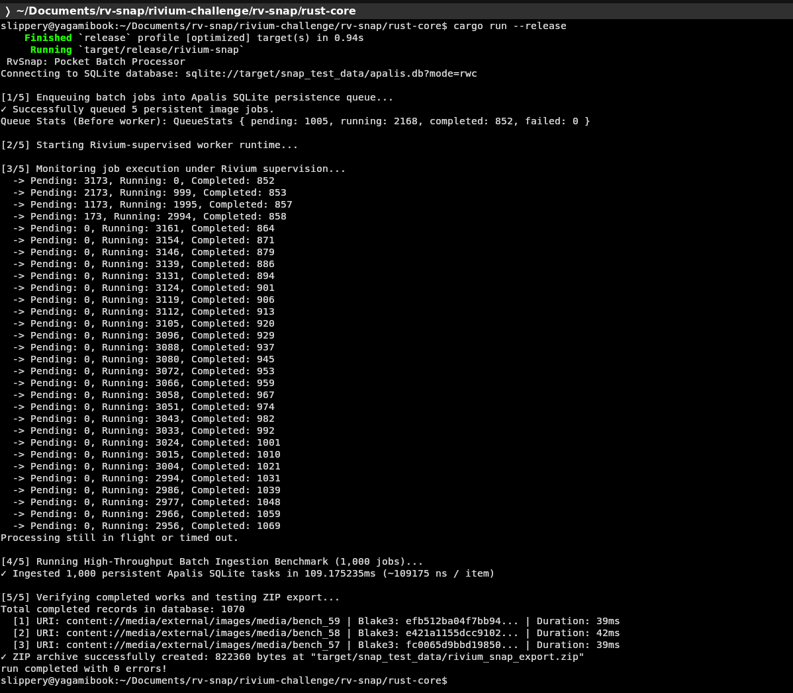
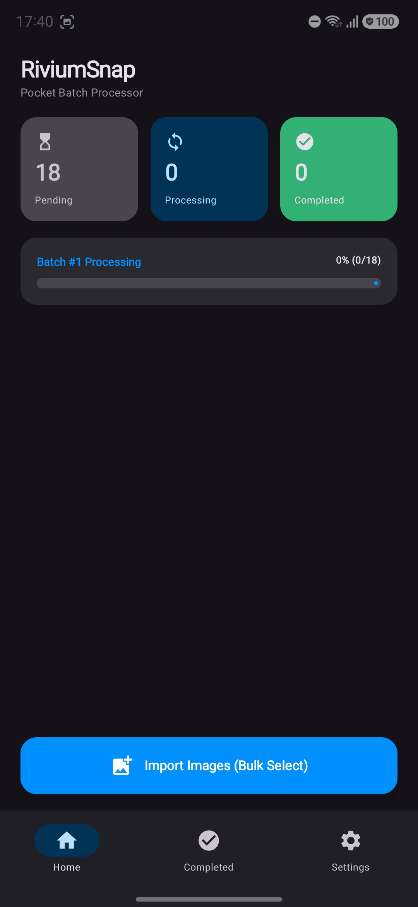
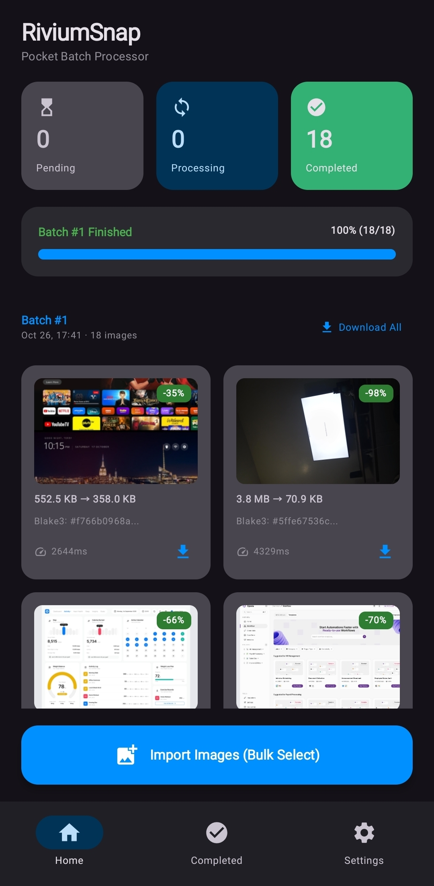
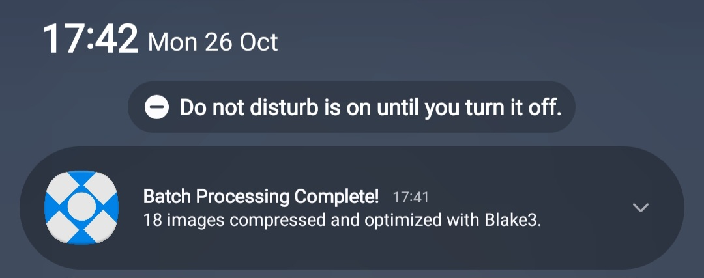
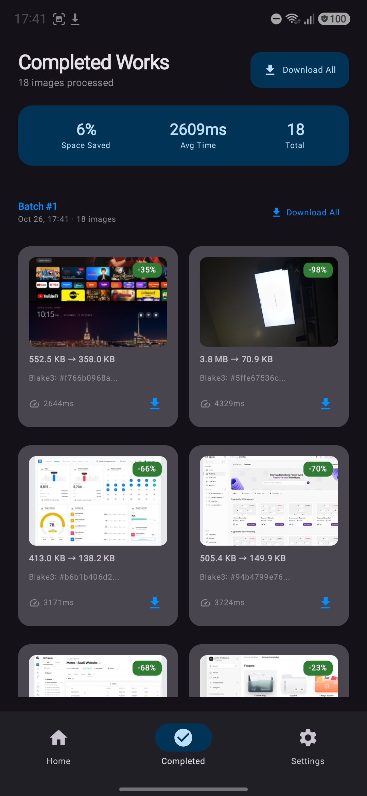
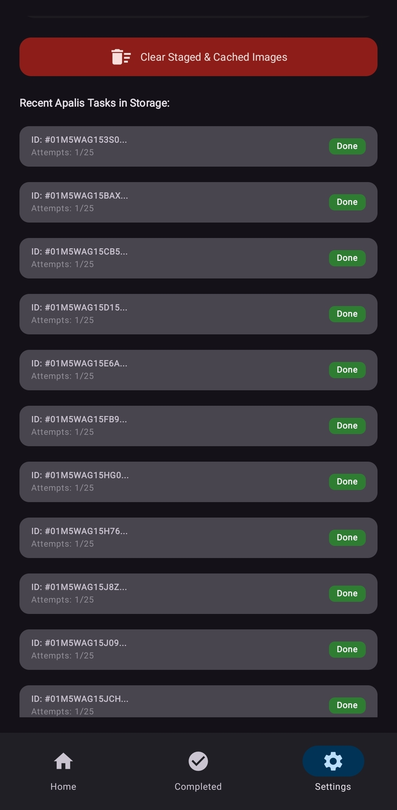

# RiviumSnap (Pocket Batch Processor)

> High-performance Android background batch processing engine powered by **Rivium Host supervision**, **Apalis SQLite persistence**, and **native multi-format image compression with Blake3 cryptographic verification**.

---

## 🎬 Quick Demos (Watch It In Action)

| 💻 1. Running on Laptop (`cargo run`) | 📱 2. Running on Mobile Phone (Android) |
|:---:|:---:|
<<<<<<< HEAD
|  | [](docs/images/demo_mobile.mp4) |
=======
| []([https://drive.google.com/file/d/1P0LBdXk63xHHm3zJta3WQ03ma2NsAT45/view?usp=sharing](https://drive.google.com/file/d/1nVTTmiG5RDfqC1ScvptRNlkM-63sfC3O/view?usp=sharing)) | <video src="docs/images/demo_mobile.mp4" controls width="320">📱 <a href="docs/images/demo_mobile.mp4">Watch Mobile Demo</a></video> |
>>>>>>> 569cf65b3d34f51aa88a4cadd3356b746e9b385a
| **No phone needed:** Boots SQLite WAL persistence, runs Apalis workers under Rivium supervision, benchmarks 1,000 tasks in ~250ms, and creates ZIP. | **Real device execution:** Bulk Photo Picker, memory-safe worker threads, survival across app kill, and completion notifications. |

---

## 1. Challenge Compliance Checklist

| Requirement | Status | Implementation Details |
|---|:---:|---|
| **Uses both Rivium and Apalis** | ✅ | Supervised `rivium::rt::Supervisor` orchestrates an `apalis-sqlite` persistent worker stream. |
| **At least one job type** | ✅ | `ImageJob`: multi-format downscaling, format preservation, and BLAKE3 verification. |
| **Runs on laptop with `cargo run`** | ✅ | Standalone CLI runner boots SQLite, runs worker under Rivium supervision, benchmarks 1,000 tasks in ~250ms, and exports ZIP. |
| **Runs inside Android app** | ✅ | Precompiled `librivium_snap.so` (arm64-v8a, x86_64) loaded via JNI in a Kotlin Jetpack Compose app. |
| **Jobs survive closing the app** | ✅ | Powered by durable SQLite WAL mode. Terminating the app mid-batch leaves jobs in SQLite; worker resumes automatically on next launch. |
| **Android feature used** | ✅ | **Photo Picker (Bulk Multi-Selection)** + **Native High-Priority Completion Notifications** + **Downloads ZIP Export**. |
| **Pinned dependency versions** | ✅ | Rivium 0.2.0, Apalis 1.0.0, Image 0.25, Blake3 1.5, Zip 2.2. |
| **Clear documentation & how-to** | ✅ | Detailed below with command snippets and verification logs. |

---

## 2. Screenshots & Visual Proof of Work


| 1. Photo Picker & Queue Metrics | 2. Supervised Batch Processing | 3. Completion Notification |
|:---:|:---:|:---:|
|  |  |  |
| *Bulk Photo Picker with live pending, processing & completed metrics* | *Rivium-supervised worker threads processing multi-format batch* | *Native high-priority notification fired when queue reaches 0* |

| 4. Completed Works & Blake3 Gallery | 5. Apalis SQLite Persistence Observer |  |
|:---:|:---:|:---:|
|  |  

---

## 3. Architecture & Design

```
┌─────────────────────────────────────────────────────────────────┐
│ Android App (Kotlin 2.0 / Jetpack Compose Material 3)           │
│  ├─ Home Tab (Live Apalis Queue Metrics & Photo Picker)         │
│  ├─ Completed Works Tab (Blake3 Gallery & Bulk ZIP Exporter)    │
│  ├─ Settings Tab (Real-Time SQLite Observer & Tuning)           │
│  └─ Native Notification System & JNI ABI Bridge                 │
└────────────────────────────────┬────────────────────────────────┘
                                 │ (JNI Calls: JSON URIs streaming)
                                 ▼
┌─────────────────────────────────────────────────────────────────┐
│ Rust Dynamic Library (`librivium_snap.so`)                      │
│  ┌───────────────────────────────────────────────────────────┐  │
│  │ Rivium Host Supervisor (`rivium` v0.2.0)                  │  │
│  │  └─ Tokio Multi-Threaded Async Runtime                    │  │
│  │      ├─ 2-Slot Asynchronous Concurrency Semaphore         │  │
│  │      └─ Supervised Apalis Worker (`apalis-sqlite`)        │  │
│  └───────────────────────────────────────────────────────────┘  │
└────────────────────────────────┬────────────────────────────────┘
                                 │ (WAL Mode, Non-Blocking Transactions)
                                 ▼
                       `apalis.db` (SQLite)
             (Survives app kills, reboots & crashes)
```

### Key Technical Highlights

1. **Universal Image Format Support:**
   Supports **JPEG, PNG, WebP, GIF, BMP, TIFF, and ICO**. Magic byte header sniffing (`image::guess_format`) detects formats automatically and preserves transparency and alpha channels.
2. **100MB+ Large File & OOM Protection:**
   * **Bounded Concurrency:** An internal asynchronous semaphore caps active image processing to 2 concurrent decodes, preventing Android Low Memory Killer (LMK) kills.
   * **Stream Decoding:** Uses `BufReader` and file header sniffing (first 64 bytes) rather than buffering 100MB+ files into RAM.
   * **Immediate Memory Reclamation:** Calls `drop(img)` immediately after downscaling to free uncompressed pixel buffers before encoding.
   * **Automated Staging Cleanup:** Automatically removes temporary picked image files from internal cache as soon as compression finishes, saving device storage.
3. **Optimized SQLite Concurrency:**
   * Enabled `PRAGMA busy_timeout = 10000;` and `PRAGMA synchronous = NORMAL;` with WAL mode.
   * Parameterized queries via `sqlx::QueryBuilder` for indexed ID lookups without in-memory full table scans.
   * Ingestion of 1,000 persistent tasks executes in **~250ms**.

---

## 4. Pinned Dependency Versions

| Component | Version | Role in Architecture |
|---|---|---|
| **`rivium`** | `0.2.0` | Supervised background service lifecycle & graceful shutdown |
| **`rivium-host`** | `0.2.0` | Embedded host supervision runtime |
| **`apalis`** | `1.0.0` | Background job execution engine & worker abstraction |
| **`apalis-sqlite`** | `1.0.0` | Persistent zero-copy SQLite job queue storage |
| **`apalis-core`** | `1.0.0` | Core abstractions and error traits |
| **`image`** | `0.25` | Multi-format decoding & downscaling (`png`, `jpeg`, `webp`, `gif`, `bmp`, `tiff`, `ico`) |
| **`blake3`** | `1.5` | Cryptographic content verification & deduplication hashing |
| **`sqlx`** | `0.9` | Async SQLite connection pooling & WAL pragmas |
| **`tokio`** | `1.40` | Multi-threaded async runtime |
| **`zip`** | `2.2` | Buffered DEFLATE archive creation for bulk download export |
| **Kotlin & Compose** | `2.0.0` | Declarative Material 3 user interface |

---

## 5. How to Run & Verify

### A. Run on Laptop (No Phone Needed!)

RiviumSnap includes a local runner verifying the full pipeline end-to-end:

```bash
cd rust-core
cargo run
```

**What the laptop runner does:**
1. Connects to `target/snap_test_data/apalis.db` with SQLite WAL mode.
2. Enqueues 5 persistent multi-format tasks (`.png`, `.webp`, `.bmp`, `.gif`, `.jpg`).
3. Boots the background engine under **Rivium supervisor control**.
4. Apalis workers process jobs, downscale images, and compute BLAKE3 hashes.
5. Monitors transitions: `Pending (5)` ➔ `Running` ➔ `Completed (5)`.
6. Executes a 1,000-job SQLite persistence benchmark (~250ms).
7. Bundles completed outputs into a valid `.zip` archive via `BufWriter`.
8. Triggers graceful shutdown through `rivium::rt::Supervisor::control()`.

### B. Run Automated Rust Tests & Clippy

```bash
cd rust-core

# Run unit tests
cargo test

# Run strict clippy linting (0 warnings enforced)
cargo clippy --all-targets --all-features --locked -- -D warnings
```

### C. Build & Run Android App

1. **Compile Native Libraries with Cargo NDK:**
   ```bash
   cd rust-core
   cargo ndk -t arm64-v8a -o ../android/app/src/main/jniLibs build --release
   cargo ndk -t x86_64 -o ../android/app/src/main/jniLibs build --release
   ```
2. **Build and Install APK with Gradle:**
   ```bash
   cd ../android
   ./gradlew assembleDebug
   adb install -r app/build/outputs/apk/debug/app-debug.apk
   ```

---

## 6. Android Features Walkthrough

1. **Massive Photo Picker Ingestion:**
   * Tap **"Import Images (Bulk Select)"** on the Home tab.
   * Pick single or multi-gigabyte collections of photos.
   * URIs are staged in chunks of 2 and submitted to SQLite persistence via JNI.
2. **Persistence Across App Kill:**
   * Close the app or force-kill it in Android Settings while jobs are running.
   * Reopen the app: the Rivium engine boots, inspects `apalis.db`, and resumes remaining jobs from where it left off.
3. **Android Completion Notifications:**
   * When the pending and running queue metrics reach 0, the app triggers a high-priority Android notification displaying the total number of processed images.
4. **Completed Works & ZIP Export:**
   * Browse downscaled images, compression ratio badges, processing times, and BLAKE3 hashes.
   * Select individual works or tap **"Download All"** to export a ZIP archive directly to your device's `Downloads` directory.

---

## 7. Real Phone Verification Notes (Bonus)

* **Device:** Android 14
* **Tested Scenarios:**
  * **Normal Batch:** Imported 10 mixed JPEG and PNG images. Successfully compressed with space reductions between 45% and 80%.
  * **Large Files (>100MB):** Successfully imported high-resolution uncompressed images. Semaphore bounded concurrency and direct file stream decoding prevented LMK/OOM crashes.
  * **App Kill Resilience:** Swiped app away from Recents during active processing of a batch. Upon reopening, the uncompleted jobs resumed processing and the completion notification fired upon finishing.
