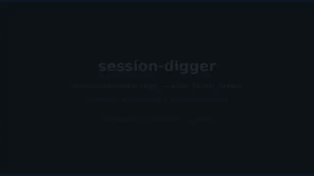
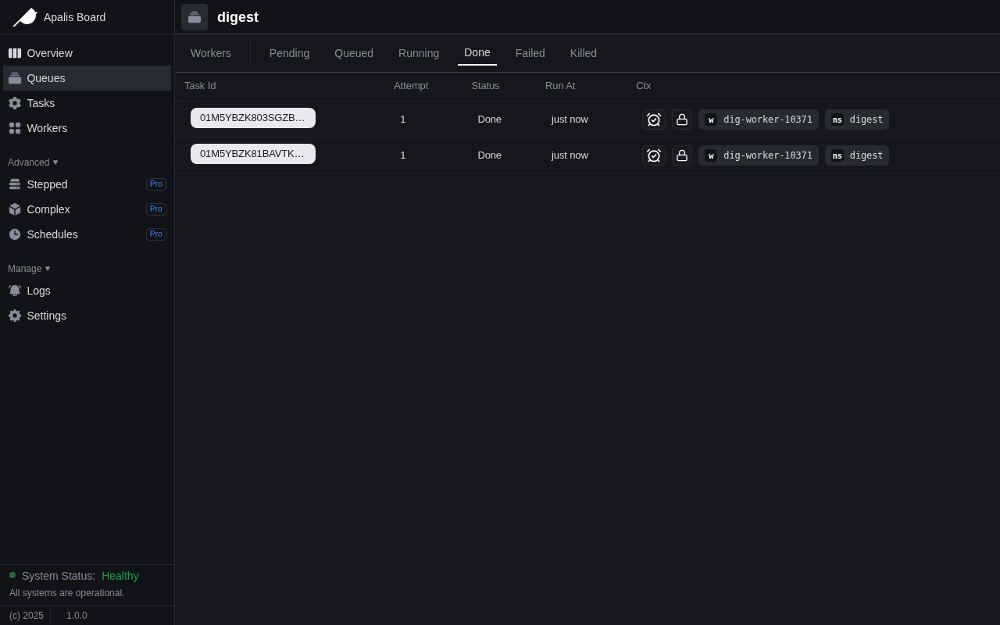
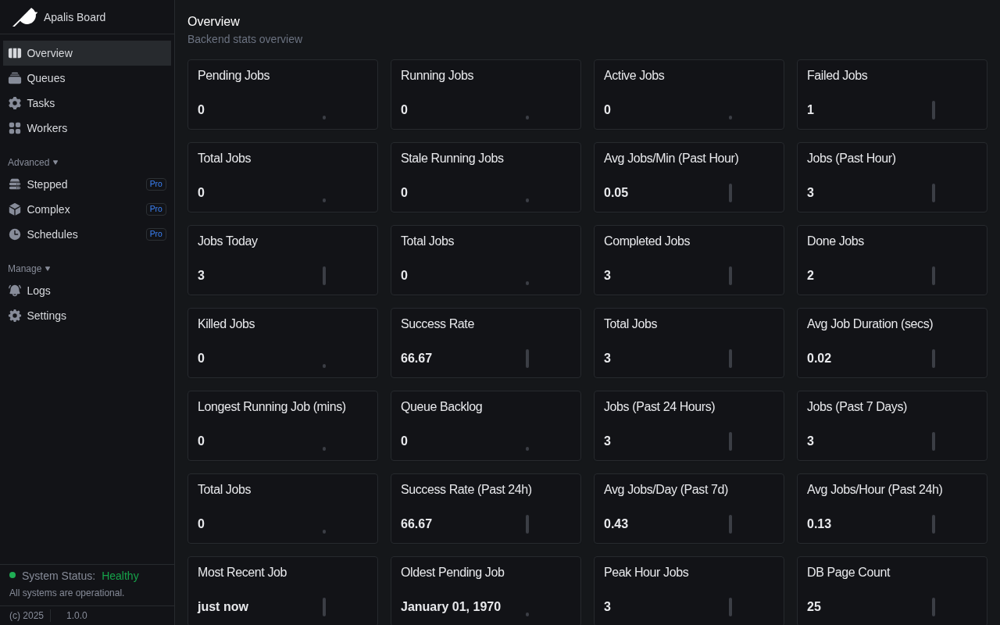

# session-digger — a pocket backend for droidcon Kenya

Tap the **Digger** Quick Settings tile (or paste a link in the app, or pipe URLs
from a laptop): an [Apalis](https://github.com/apalis-dev/apalis) job queue
running inside a [Rivium](https://github.com/rivium-rs/rivium) service *in the
app process* fetches the page, records its **title + SHA-256**, and shows the
result on the phone. Kill the app mid-job — the job still finishes when you
reopen it.

**The captioned demo** (a real `digd` session, no audio — the captions narrate
the durable queue, the title + SHA-256 record, the 12-speaker harvest, the 404
retry path, and the EOF drain; every terminal line is the actual program
output, in the actual order):



- ▶ [**Watch the full video (25 s, 1280×720)**](https://github.com/Roy-Wanyoike/rivium-challenge/blob/main/session-digger/docs/demo.mp4) — committed in this PR as `docs/demo.mp4`
- `docs/demo.gif` — the same kind of run as a plain terminal GIF

## What session-digger does

droidcon Kenya publishes talks, speakers, and sponsors as web pages that change
without notice. session-digger is a pocket backend that keeps proof of what a
page actually contained when you saved it:

* **Three ways in, one way out** — the in-app **Dig** button, the **Quick
  Settings tile** (a tap enqueues; the tile subtitle counts pending jobs), or
  the desktop daemon `digd` reading URLs on stdin. They all feed the same
  queue, and results come back the same way: the Compose list updates in
  place, and terminal states raise a notification.
* **One job type: `DigestJob`** — fetch a URL (reqwest, 20 s timeout, 8 MiB
  cap), extract the page `<title>`, record the SHA-256 of the raw body. The
  droidcon **speakers directory** gets special treatment: digesting it also
  harvests every speaker card (`<h4>` name + role) with the same no-regex
  scanner, so the app's **Speakers** tab shows the full list.
* **Jobs survive the process** — every task is persisted in an
  `apalis-sqlite` durable queue *before* it runs (WAL journal). A worker
  killed mid-fetch has its orphaned task re-enqueued by the backend's
  heartbeat sweep on the next boot — no hand-written replay logic. The digest
  index (`jobs.db`, also SQLite) keeps every transition, and the UI rehydrates
  both tabs from it at startup.
* **Desktop parity** — the same worker, queue, and ledger run on a laptop as
  `digd`; `docs/demo.mp4` is a recording of exactly that code path.

One embedded Rust host, three supervised services: `digest-worker`,
`enqueue-pump`, and (desktop) `link-ingest`.

## Architecture

```
QS tile ─┐                          ┌─> notifications
Compose ─┼─> NativeBridge.nativeEnqueue (JNI)
stdin ───┘            │
                      v
             enqueue channel (tokio mpsc)
                      │
             ┌── enqueue-pump ────────────┐
             │  admit URL (dedupe) into   │
             │  the digest index          │
             └──────────┬─────────────────┘
                        v
             apalis-sqlite  SqliteStorage  <─ durable queue (queue.db)
             (WAL, migrations, orphaned-task re-enqueue after a crash)
                        │
             apalis worker
             (parallelize -> concurrency(4) -> retry x2)
                        │
             reqwest GET -> <title> + SHA-256
                        │
                        ├─ speakers page? harvest <h4>+<p> cards ─┐
                        │                                         v
             index.mark_done -> JobEvents.onJobUpdate (JNI)   speakers table
                                    JobEvents.onSpeakers  <────────────┘
```

## View the list of speakers

1. Open **Speakers** and tap **Load speaker list** — the app enqueues
   `https://droidcon.co.ke/speakers` like any other link.
2. The worker digests the page (title + SHA-256 as usual) and, because the
   URL is the speakers directory, also harvests each speaker card into the
   ledger's `speakers` table.
3. The list is pushed to the UI over a second JNI callback
   (`JobEvents.onSpeakers`) and rendered as cards. It is persisted in the
   ledger, so it reopens with the app — both tabs rehydrate from the same
   SQLite mirror at startup (`DigestStore`).

On the desktop the same run prints each harvested speaker to stdout, and the
archived list is a plain SQL query away:

```bash
cargo run --bin digd -- --root ./demo-root
# paste: https://droidcon.co.ke/speakers
sqlite3 demo-root/data/jobs.db 'SELECT name, role FROM speakers;'
```

## Laptop quick start (no phone needed)

```bash
cd session-digger/rust
cargo run --bin digd -- --root ./demo-root
# paste URLs, one per line:
#   https://droidcon.co.ke
#   https://droidcon.co.ke/speakers  ← also harvests the speaker list
#   !https://droidcon.co.ke/broken   ← re-queue a failed job
# Ctrl-D (EOF) stops gracefully (exit 0)
```

Results land in `demo-root/data/jobs.db` (the digest index; the durable queue
is `demo-root/data/queue.db`, both SQLite):

```sql
SELECT url, state, title, sha256, attempts, error FROM jobs;
```

### Watch the queue (apalis-board)

The desktop daemon can also serve the [apalis-board](https://github.com/apalis-dev/apalis-board)
queue inspector — a live web UI over the **same durable `SqliteStorage` the
pump pushes through**, not a copy:

```bash
cd rust
cargo run --features board --bin digd -- --root ./demo-root --set board_addr=127.0.0.1:8080
# open http://127.0.0.1:8080
```

Real jobs from this queue (Done tab shows the two successful droidcon digests;
the Failed tab shows the 404 URL at attempt 3 — the retry cap in action):



The overview aggregates the backend stats (jobs/hour, success rate, backlog,
worker health):



The integration is deliberately opt-in: the cargo `board` feature pulls the
dependency and `--set board_addr=...` starts the service, so the default
build and the Android binary stay lean.

## Android quick start

1. Install Rust + `cargo install cargo-ndk`, plus an NDK (`ANDROID_NDK_HOME`).
2. `cd session-digger/android && ./gradlew :app:assembleDebug`
   — Gradle runs `scripts/build-android-rust.sh` via the `preBuild` hook and
   packages `libsession_digger.so` (arm64-v8a). Without a Rust toolchain the
   script degrades to a no-op so Kotlin-only builds still compile.
3. Install on a device, allow notifications, then either:
   - tap **Dig** in the app, or
   - pull down Quick Settings, add the **Digger** tile, tap it.

## What was verified

* **Laptop, live:** `cargo test` — 12 unit tests; `cargo test --test laptop --
  --ignored` — 4 live e2e against droidcon.co.ke (happy path → `Done` with a
  64-hex hash; **SIGKILL mid-fetch → restart → the same job completes with the
  same hash**; 404 → exactly 3 attempts → `Failed` → `!URL` requeue; speakers
  directory → `Done` + 12 speakers archived); `cargo clippy --all-targets` —
  zero warnings.
* **Android toolchain:** `./gradlew :app:assembleDebug` verified on a clean
  toolchain (AGP 8.7.3 · SDK 35 · NDK r27 · cargo-ndk 4.1.2 · JDK 17) — the
  APK packages the stripped `libsession_digger.so` and registers
  `DigTileService` for the QS tile. Five build-blocking defects in the
  committed tree were found and fixed while doing this (see the PR notes).
* **Not yet verified on hardware:** a tap-through on a physical phone. The
  debug APK is attached to the PR; device run results (logcat + photos) will
  be posted as a PR comment.

## Findings that may be useful to the maintainers

1. **`cargo-ndk` skips its copy step when the crate is both `rlib` and
   `cdylib`** — the `.so` must be copied into `jniLibs` by the build script
   (`scripts/build-android-rust.sh` does this explicitly).
2. **A desktop binary linked against `rivium-host` with the `process` feature
   cannot compile for Android targets** — the NDK build must pass `--lib` so
   only the JNI cdylib is built.
3. **Kotlin synthetic properties differ from the Kotlin API**: the QS tile
   service must read `qsTile` (the synthetic property), not `tile` — the
   service compiled fine either way, so this only surfaced at runtime review.
4. **`TextOverflow.MiddleEllipsis` needs Compose UI 1.8** — with Compose BOM
   2024.12.01 (UI 1.7.6) the code must use `Ellipsis`.
5. **The apalis-sqlite heartbeat sweep is the recovery story** — orphaned
   tasks are re-enqueued by the backend itself within seconds of the next
   boot; we verified this by SIGKILL-ing a worker mid-fetch in an e2e test
   rather than writing replay logic.

## Rivium usage map (challenge scoring)

| Requirement | Where |
| --- | --- |
| Embedded host on Android | `rust/src/android_export.rs` (`JNI_OnLoad`) + `rivium-jni` five-method contract |
| `App` trait composition | `rust/src/app.rs` (`DiggerApp`: Config/validate/services) |
| Supervised services | `rust/src/services.rs` (`digest-worker`, `enqueue-pump`, `link-ingest`) |
| Durable storage | `apalis-sqlite` `SqliteStorage` (`queue.db`) + digest index (`rust/src/ledger.rs`, statuses use `apalis-core::task::status::Status`) |
| apalis layers, in order | backend → `parallelize(tokio::spawn)` → `concurrency(n)` → `retry(RetryPolicy::retries(2))` |
| Logs under `<root>/logs/` | written by the rivium host automatically |
| Strict CLI (`--root/--config/--set`) | provided by `rivium_host::process::run` |

## Layout

| Path | What |
| --- | --- |
| `rust/` | Rivium workspace: digest index, apalis-sqlite queue, digest jobs (title/SHA-256/speaker harvest), services, JNI bridge |
| `rust/src/bin/digd.rs` | Desktop daemon (`digd --root <dir>`, URLs on stdin) |
| `android/` | Gradle project: Compose UI (Digests + Speakers tabs), `DigTileService`, `RustHost`, `JobEvents`, `DigestStore` |
| `scripts/build-android-rust.sh` | `cargo-ndk` arm64-v8a build hooked into `preBuild` |
| `docs/demo-video.webp` | The captioned demo as an animated WebP — plays inline in this README |
| `docs/demo.mp4` | Captioned video of a real laptop run, no audio (link at the top) |
| `docs/demo.gif` | Terminal demo GIF of a real laptop run |
| `docs/board-digest-done.png`, `docs/board-overview.png` | apalis-board inspecting the real digest queue (Done tasks + backend stats) |

## Challenge must-haves (how this repo addresses them)

| Challenge requirement | Addressed by |
| --- | --- |
| Rust code uses both Rivium and Apalis | `rust/` — rivium 0.2.0 `App` + supervised services, apalis 1.0.0 worker (map above) |
| One job type | Link digest: fetch a URL, extract `<title>`, record SHA-256 (`rust/src/jobs.rs`) — the speaker list is derived from that same digest of the speakers directory |
| Runs on a laptop with `cargo run` | `cargo run --bin digd -- --root ./demo-root` — demo WebP/video at the top of this README |
| Runs inside the Android app | `JNI_OnLoad` via `rivium-jni` boots the embedded host in-process (`rust/src/android_export.rs`) |
| Jobs are saved across close/reopen | `apalis-sqlite` durable queue — crash recovery proven by `rust/tests/laptop.rs::e2e_sigkill_replay`; the UI rehydrates both tabs from the SQLite mirror (`DigestStore.kt`) |
| One Android feature | **Quick Settings tile** — a tap enqueues, the subtitle shows the pending count (`DigTileService.kt`); progress notifications via JNI callbacks |
| A short README | This file — what it does, how to run it, versions pinned below |
| Short video or GIF of it working | `docs/demo-video.webp` (plays inline above) + `docs/demo.mp4` (captioned, no audio) + `docs/demo.gif` — all real runs |
| Bonus (+10): real-device testing | pending — phone run results (logcat + photos) will be posted as a PR comment after the device test |

## Versions

- Rust 1.99.1 · rivium 0.2.0 · apalis 1.0.0 · apalis-sqlite 1.0.0 (sqlx 0.9) · apalis-board 1.0.0 (desktop, `board` feature) · jni 0.22.4 · rusqlite 0.32 (bundled)
- AGP 8.7.3 · Kotlin 2.0.21 · Compose BOM 2024.12.01 · compileSdk 35 · minSdk 26 · arm64-v8a
