<p align="center">
  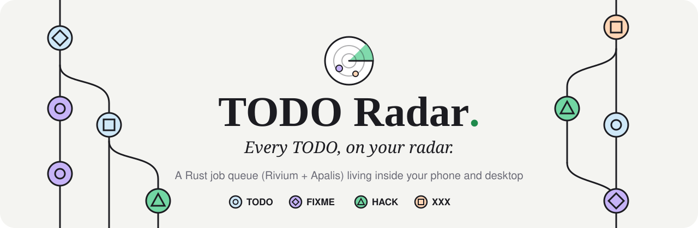
</p>

<p align="center">
  <a href="#-run-it"></a>
  
  
  
  
  
  
</p>

<p align="center">
  <b>Sign in with GitHub, pick a repo, and a Rust worker living <i>inside your phone</i> downloads it,<br/>
  finds every <code>TODO</code> · <code>FIXME</code> · <code>HACK</code> · <code>XXX</code>, and tells you what changed since last time.</b><br/>
  <sub>Rivium + Apalis "pocket backend" challenge entry · one Rust engine, embedded via JNI in Android <b>and</b> Desktop</sub>
</p>


<p align="center">
  
  <br/><sub>23 s demo built from real screen recordings on a real device (Android 13): search → Large repo → live scan → 919 TODOs → filters & code peek → gooey swipes → notification.</sub>
</p>

---

<table>
<tr>
<td align="center" width="25%">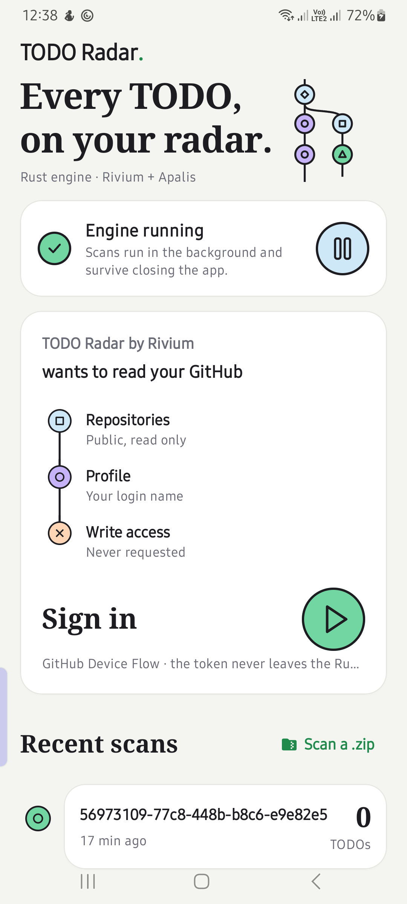<br/><sub><b>Home</b>: engine status and GitHub-style access card</sub></td>
<td align="center" width="25%">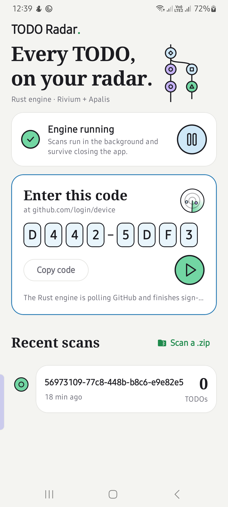<br/><sub><b>Device Flow</b>: code to enter on github.com</sub></td>
<td align="center" width="25%">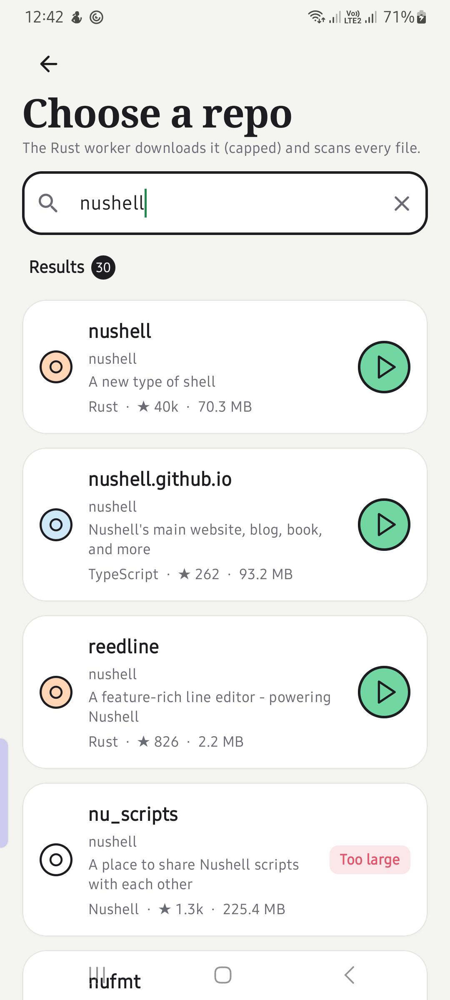<br/><sub><b>Pick a repo</b>: search, size cap, round ▷ scan</sub></td>
<td align="center" width="25%">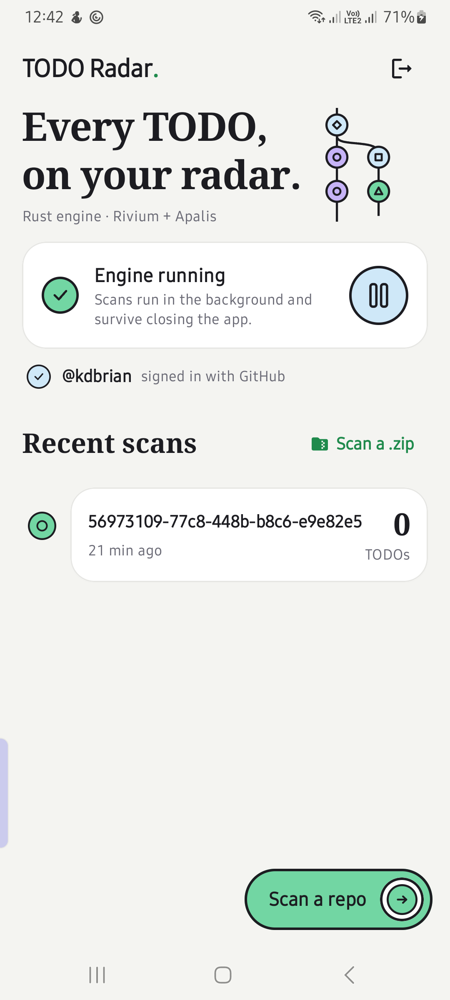<br/><sub><b>Signed in</b>: scan history as a commit graph</sub></td>
</tr>
</table>

<table>
<tr>
<td align="center" width="33%">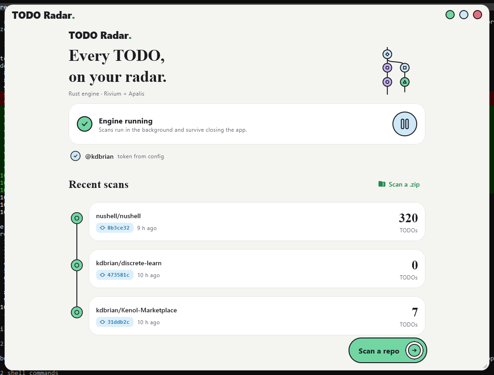<br/><sub><b>Desktop</b>: frameless rounded window, same engine</sub></td>
<td align="center" width="33%">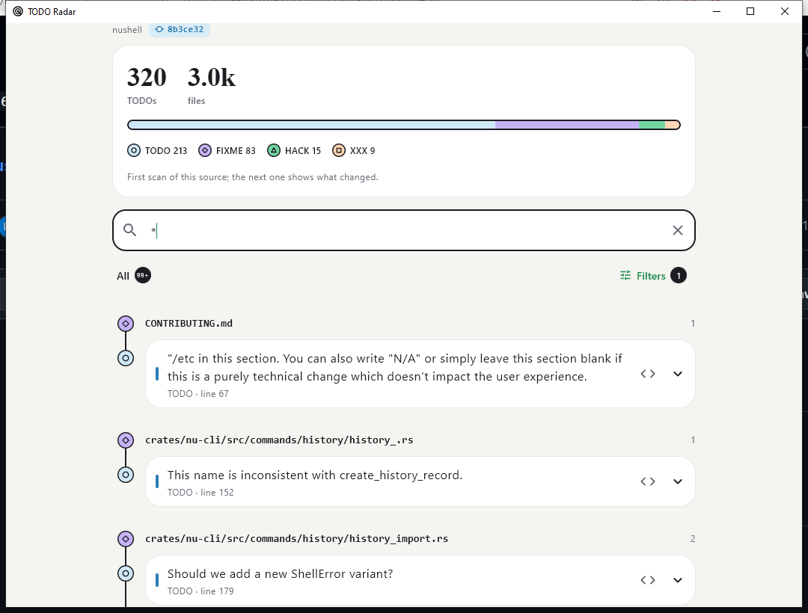<br/><sub><b>Results</b>: tag breakdown, rails per file</sub></td>
<td align="center" width="33%">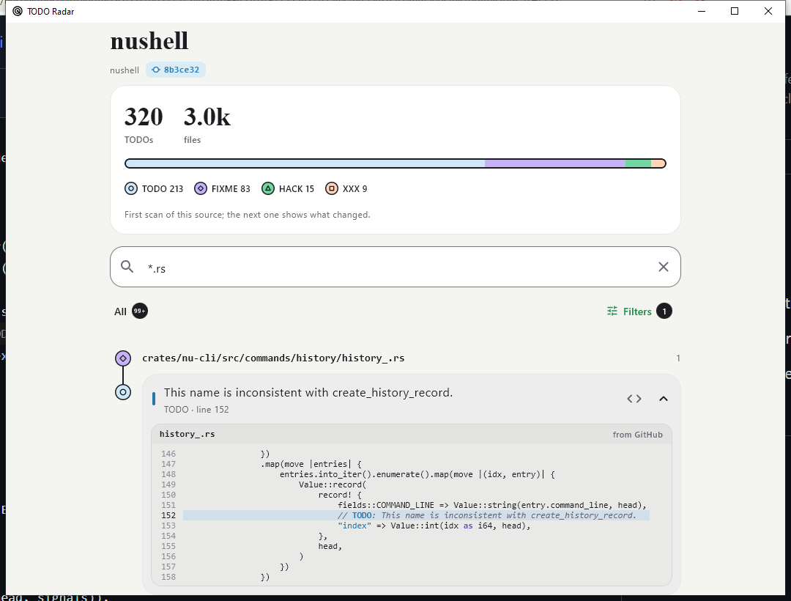<br/><sub><b>Code peek</b>: the TODO in context</sub></td>
</tr>
</table>

## 🧭 Contents

[Why](#-why-this-exists) · [Feature tour](#-feature-tour) · [Features](#-features) · [Challenge checklist](#-challenge-checklist) · [Ideation](#-ideation) · [Architecture](#%EF%B8%8F-architecture) · [Android feature](#-the-android-feature) · [Persistence](#-persistence--recovery-measured) · [Design language](#-design-language) · [Stack](#-stack--pinned-versions) · [Run it](#-run-it) · [API](#-engine-api) · [Branching](#-branching) · [Maintainer notes](#-findings-for-the-rivium--apalis-maintainers) · [Real device](#-real-device-report)

---

## 🎞️ Feature tour

<sub>Real captures from a real device (Android 13), cropped to the feature.</sub>

<table>
<tr>
<td width="50%" valign="top">
<b>1 · Sign in with GitHub Device Flow</b><br/>
<sub>The Rust engine requests a code and polls GitHub in the background, so you can authorize from any device.</sub><br/><br/>
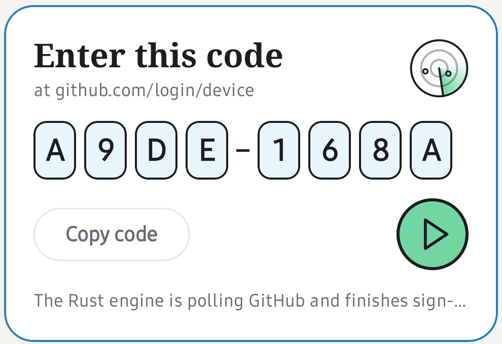
</td>
<td width="50%" valign="top">
<b>2 · Pick any repo, even large ones</b><br/>
<sub>Search GitHub; over 100 MB is flagged <i>Large</i> but still scannable (hard cap 1 GB).</sub><br/><br/>
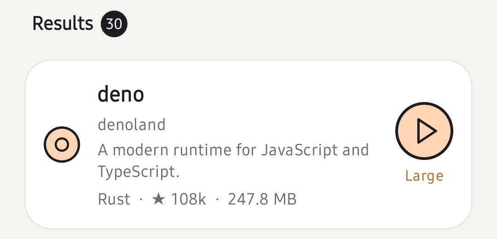
</td>
</tr>
<tr>
<td valign="top">
<b>3 · Live scan, stage by stage</b><br/>
<sub>Resolve ◇ → Download □ → Scan △ → Diff ○, checkpointed so Pause, a crash or a force-stop resumes where it stopped.</sub><br/><br/>
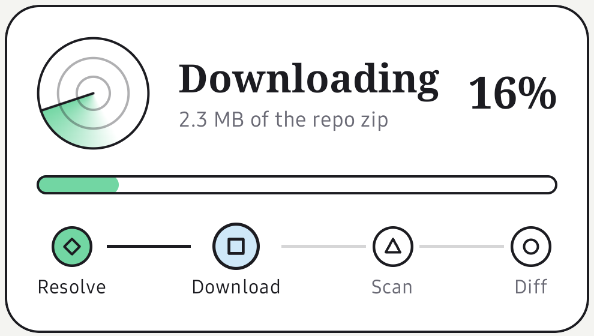
</td>
<td valign="top">
<b>4 · Results at a glance</b><br/>
<sub>deno: 919 TODOs across 19k files, broken down by marker.</sub><br/><br/>
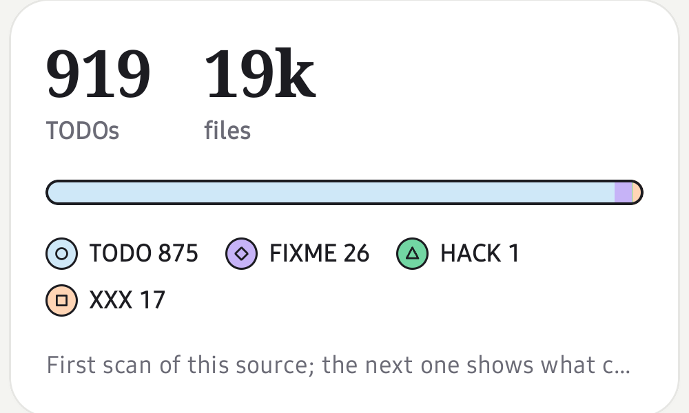
</td>
</tr>
<tr>
<td valign="top">
<b>5 · Advanced filters</b><br/>
<sub>Marker, file type (<code>.rs · 463</code>) and text or glob (<code>src/**/*.rs</code>).</sub><br/><br/>
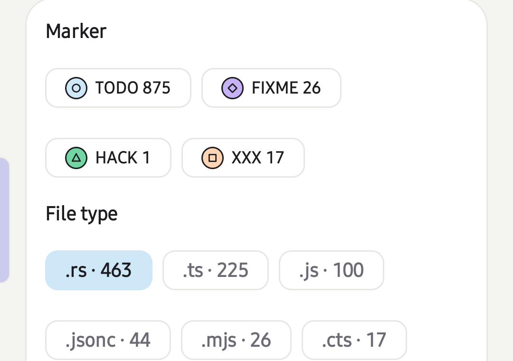
</td>
<td valign="top">
<b>6 · Code peek</b><br/>
<sub>Expand any TODO: line numbers, highlighted line, syntax tint; from the zip or GitHub at the scanned commit.</sub><br/><br/>
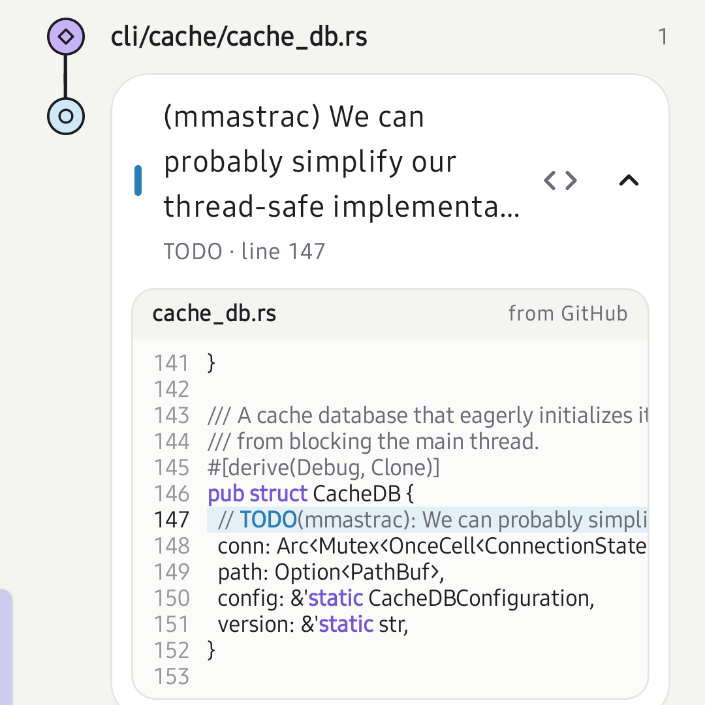
</td>
</tr>
<tr>
<td valign="top">
<b>7 · The notification is the control panel</b><br/>
<sub>Result with <b>Open · Keep · Delete now</b>; during a scan it carries live progress and <b>Pause / Resume</b>.</sub><br/><br/>
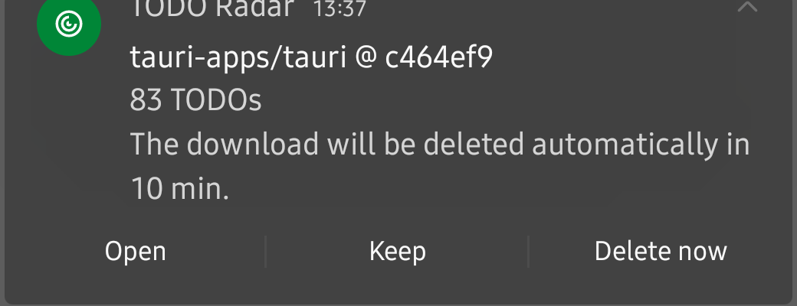
</td>
<td valign="top">
<b>8 · Downloads delete themselves by default</b><br/>
<sub>A delayed Apalis job removes each zip after 10 min unless you keep it, even across restarts.</sub><br/><br/>
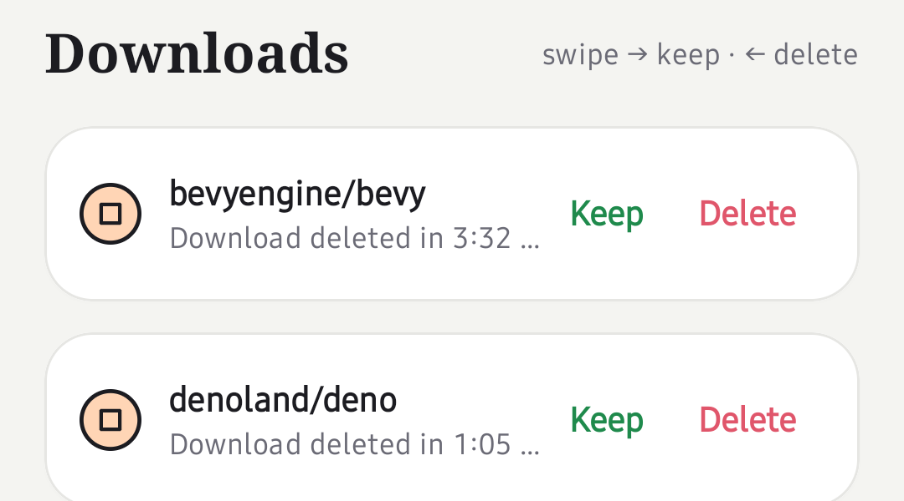
</td>
</tr>
<tr>
<td valign="top">
<b>9 · Gooey swipe actions</b><br/>
<sub>← 🗑 delete · → ✓ keep (and on TODO rows: → open, ← share), with a haptic tick at the threshold.</sub><br/><br/>
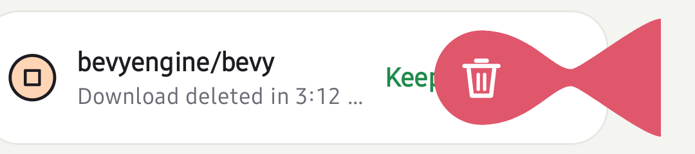<br/>
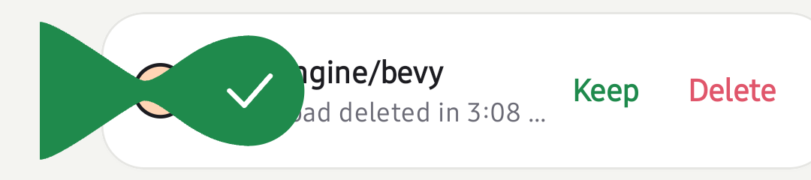
</td>
<td valign="top">
<b>10 · History as a commit graph</b><br/>
<sub>Every scan is a node on the rail, with its commit sha and TODO count.</sub><br/><br/>
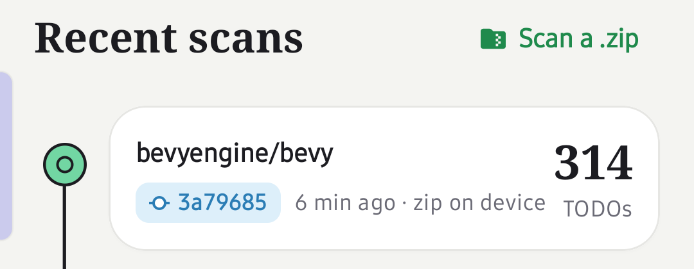
</td>
</tr>
</table>

## 💡 Why this exists

The challenge: *run a small background job queue inside an Android app and trigger it with an Android feature.* We wanted the queue to be **genuinely needed**, not decorative:

- A repo download **can fail**, so it needs retries with backoff and rate-limit handling.
- It **takes a while**, so it should survive the app being closed, paused or killed.
- The result is **comparable over time**, so we diff it against the previous scan.
- Downloads **pile up**, so a *delayed* job deletes them by default.

Every one of those is an Apalis job concern, and every lifecycle edge (pause, resume, crash) is a Rivium concern.

## ✨ Features

| | Feature | Where the work happens |
|---|---|---|
| 🔐 | **GitHub Device Flow sign-in**: no password, no backend, no client secret; a background poller finishes sign-in even while you authorize on another device | Rust `github.rs` + `api.rs` |
| 🔎 | **Search your repos or all of GitHub**; repos over 100 MB are flagged *Large* (still scannable) and over 1 GB *Too large* | Rust `/repos` |
| 📦 | **Streamed, capped zipball download** with resumable checkpoints every 256 KB | Apalis job `ScanRepo` |
| 🧮 | **Checkpointed scan**: 200 files per transaction, resumes from the exact entry after a crash | `ScanRepo` + `store::checkpoint` |
| 🆚 | **Diff vs the previous scan** (`+new / −resolved`) via fingerprints that ignore line moves | `store::finish` |
| ⏸️ | **Pause / Resume** from the notification or the app: a real Rivium `nativeStop` / `nativeStart` | Android `EngineService` → JNI |
| 🧹 | **Default delete**: the zip is removed after 10 min unless you **Keep** it (a *delayed* Apalis job that survives restarts) | Apalis job `CleanupScan` |
| 🗂️ | **Keeps the last 5 scans** per repo | `CleanupScan` pruning |
| 🔁 | **Rescan** from any scan (Android and desktop): a new commit is diffed against the last scan; the same commit returns instantly ("no changes") | shared `ScanViewModel.rescan` → `POST /scans` |
| 🔬 | **Advanced filters**: marker (○◇△□), file type chips (`.rs 213`), glob or text pattern (`src/**/*.rs`) | shared `ScanViewModel` |
| 👀 | **Code peek**: expand any TODO to see ±6 lines with line numbers and highlighting, from the zip or from GitHub at the same commit | Rust `/peek` + `CodePeek` |
| 🫧 | **Gooey swipe actions** (from our UI inspiration): ✓ keep, 🗑 delete, → open, ↗ share | shared `GooeySwipe` |
| 📤 | **Share out**: one TODO with a deep link (`#L42`), or a Markdown report | Android share sheet / desktop clipboard |
| 📥 | **Share in**: a `.zip` from Files or a browser, scanned **offline** | `ZipShareActivity` → Rust |
| 🖥️ | **Same engine on desktop**: frameless rounded window, custom title bar, tray notifications | Compose Desktop |

## ✅ Challenge checklist

| Requirement | How TODO Radar meets it | Where |
|---|---|---|
| Rust uses **Rivium** and **Apalis** | `RadarApp: rivium_host::App` runs a `worker` service (Apalis `Monitor`, 2 workers) and an `api` service (`rivium_http::HttpServer`) | [`lib.rs`](rust/radar-core/src/lib.rs) |
| One job type is enough | Two: `ScanRepo` (the work) and `CleanupScan` (delayed default delete + pruning) | [`jobs.rs`](rust/radar-core/src/jobs.rs) |
| Runs on the laptop first with `cargo run` | `cargo run -p radar-core -- --root dev-root` + curl | [Run it](#1-laptop-no-phone) |
| Runs inside the Android app | `libradar_jni.so` (arm64) via `rivium_jni::export!`, started by a foreground service | [`androidApp`](client/androidApp) |
| Jobs survive closing the app | Apalis SQLite queue + scan checkpoints; recovery measured below | [Persistence](#-persistence--recovery-measured) |
| One Android feature | **Notification as the engine's control panel** (live progress, Pause/Resume, Keep/Delete now) + **Share Sheet** in/out | [Android feature](#-the-android-feature) |
| README with versions | This file, with [pinned versions](#-stack--pinned-versions) | |
| Bonus: real phone | Tested on a real device (Android 13) | [Real device report](#-real-device-report) |

## 🌱 Ideation

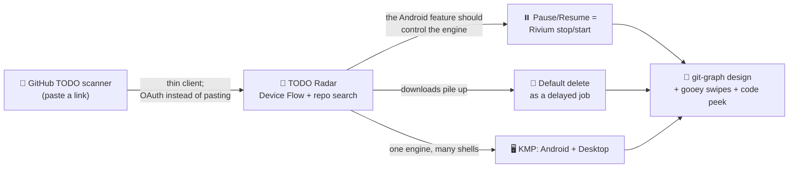

**Principles**

1. **Heavy lifting in Rust, thin clients.** The clients store nothing; one SQLite file owned by the engine is the single source of truth.
2. **The Android feature drives the engine.** Pause in the notification is a real Rivium shutdown; Resume starts a new generation.
3. **Every job can be retried safely.** The payload is just `{scan_id}`; all state lives in the `scans` row, so a retry or resume continues from the last checkpoint.
4. **Fail closed.** Size caps on metadata *and* bytes, a token-guarded loopback API, zip entries read in memory (never extracted), and files we didn't create are never deleted.

## 🏗️ Architecture

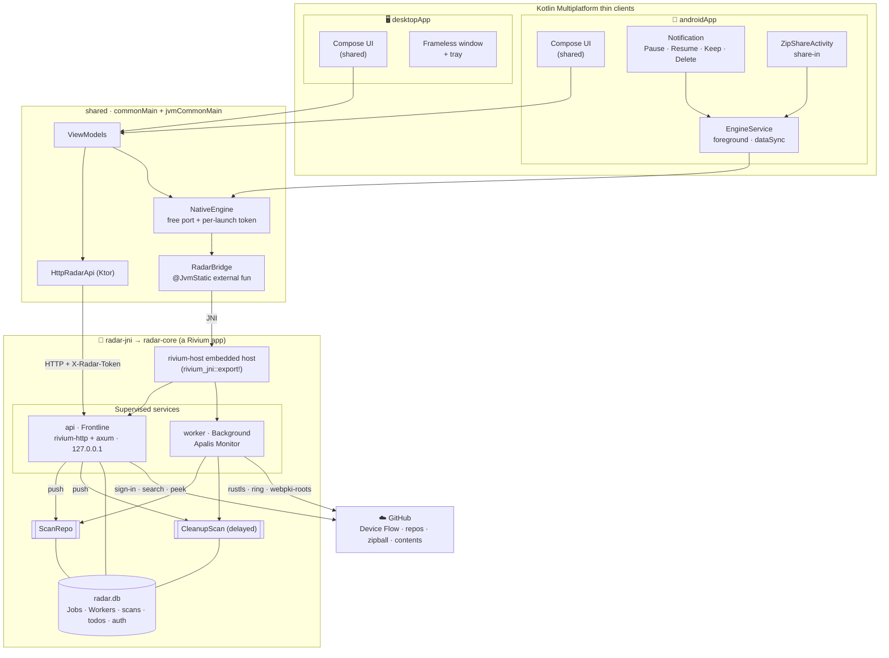

**Why a localhost API?** `rivium_jni::export!` generates exactly five static natives: `nativeStart(String[])`, `nativeStop(long)`, `nativeStatus()`, `nativeLastError()` and `nativeVersion()`. Lifecycle goes through JNI; everything else goes over loopback HTTP on a **free port** chosen per launch, guarded by a **random per-launch token** passed as `--set api_token=…`. It's the same API you drive with `curl` on the laptop.

### Scan lifecycle with Pause / Resume

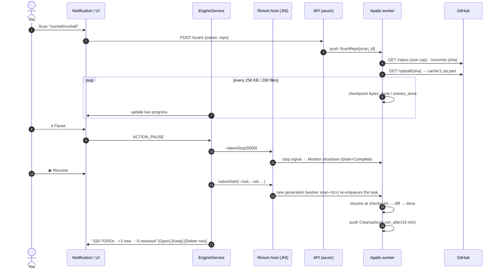

### Job state machine

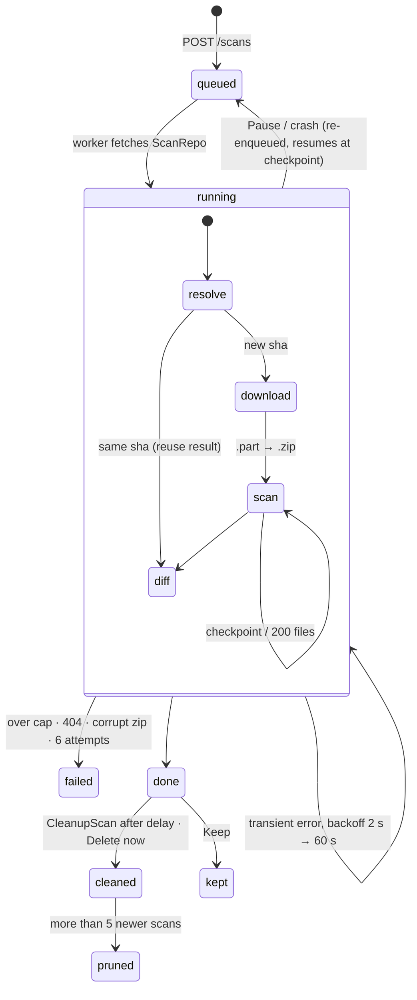

### Data model (one SQLite file)

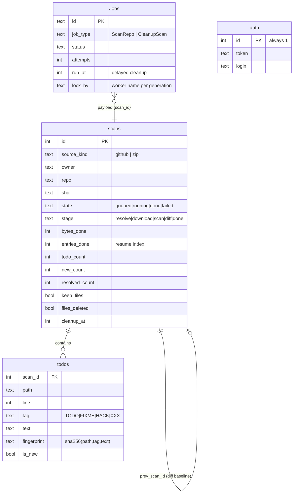

## 🔔 The Android feature

**The notification is the engine's control panel.**

| Notification | Shows | Actions | What happens in Rust |
|---|---|---|---|
| **Live scan** (ongoing, foreground) | Stage, bytes or files, %. On Android 16+: `Notification.ProgressStyle` with colour-coded stage segments and TODO milestones, promoted as a Live Update | **Pause** / **Resume** | `nativeStop(5000)`: Rivium drains services and the Apalis monitor shuts down. `nativeStart`: a new generation re-enqueues the unfinished task. |
| **Result** | `owner/repo @ sha · 320 TODOs · +3 new · −5 resolved`, plus "download deleted automatically in 10 min" | **Open** · **Keep** · **Delete now** | `/scans/{id}/keep` sets `keep_files`; `/cleanup` runs `CleanupScan` now; ignore it and the delayed job deletes the zip, even after a restart. |
| **Share Sheet in** | "Scan TODOs" target for any `.zip` | – | The zip is copied to `inbox/<uuid>/<name>.zip`, then `POST /scans {zip_path}`, scanned offline |
| **Share Sheet out** | Per TODO and per report | Share | One line with a GitHub `#L` deep link, or the `/report` Markdown |

## 🛟 Persistence & recovery (measured)

| Scenario | Mechanism | Result |
|---|---|---|
| Process **killed mid-download** (2.1 MB in) | Worker names are unique per generation; the new worker re-enqueues tasks of the dead one after 5 missed 2 s heartbeats | ✅ resumed, **done 25 s after restart**, 320 TODOs |
| Process **killed mid-scan** (entry 600/3,097) | `entries_done` saved in the same transaction as the TODO rows | ✅ resumed **from entry 600**, **0 duplicates** |
| **Pause → Resume** mid-download (desktop, embedded via JNI) | `nativeStop` → `drain=Complete active_tasks=0` in about 1 s; `nativeStart` → run 2 | ✅ finished by the second-generation worker |
| App **closed before the delete timer** | `CleanupScan` pushed with `run_after(delay)` | ✅ after a restart: `files_deleted = true` |
| **Keep** from the phone notification | `keep_files = 1`; the delayed job skips deletion | ✅ verified on a real device (Android 13) |
| Same commit scanned again | `resolve` compares the sha | ✅ instant "no changes" |

<sub>Laptop measurements from <code>scripts/e2e.sh</code> and <code>scripts/recovery.sh</code> on <code>nushell/nushell</code> (6.4 MB zipball, 3,097 entries).</sub>

## 🎨 Design language

Light only, inspired by git-graph illustrations and minimalist task lists:

| Element | Meaning |
|---|---|
| ○ sky · **TODO** · ◇ lavender · **FIXME** · △ mint · **HACK** · □ peach · **XXX** | Every marker owns a node shape and colour, used in lists, chips, the tag bar and the code peek |
| Ink rails with nodes | Scan history and TODO lists are drawn as commit graphs; files are ◇ branch nodes |
| Round mint ▷ buttons | The primary verbs: Sign in, Scan, Resume |
| Gooey edge blob | Swipe actions: ✓ keep, 🗑 delete, → open, ↗ share; a haptic tick fires past the threshold |
| Serif display + sans body | Headings like "Every TODO, on your radar."; dense info stays legible |
| Frameless desktop window | Rounded card, brand window buttons, drag and double-click title bar, resize grip |

## 🧰 Stack & pinned versions

| Layer | Crate / library | Version |
|---|---|---|
| Lifecycle | `rivium`, `rivium-host`, `rivium-http` (server), `rivium-jni`, `rivium-util` | **=0.2.0** |
| Jobs | `apalis`, `apalis-sqlite` (sqlx 0.9, bundled SQLite) | **=1.0.0** |
| HTTP | `axum` (served by `rivium_http::HttpServer`) · `reqwest` (`rustls-no-provider`) + `rustls` (`ring`) + `webpki-roots` | 0.8 · 0.13.5 · 0.23 · 1 |
| Scanning | `zip`, `regex`, `sha2` | 9 · 1 · 0.11 |
| Retries | `tower` exponential backoff via Apalis `RetryPolicy` | 0.5 |
| Toolchain | Rust (Rivium MSRV 1.92) · NDK · `cargo-ndk` · `aarch64-linux-android` API 26 | 1.99.1 · 30.0.16248370 |
| Clients | Kotlin · Compose Multiplatform · Material 3 · Ktor (CIO) · kotlinx.serialization · JetBrains lifecycle | 2.4.10 · 1.12.0 · 1.9.0 · 3.5.2 · 1.11.0 · 2.9.6 |
| Android | AGP (built-in Kotlin, `com.android.kotlin.multiplatform.library`) · compile/target/min SDK | 9.4.1 · 37/36/26 |
| Build | Gradle wrapper | 9.7.1 |
| Package | `io.github.kdbrian.rivapln.todoradar` | |

## 🗺️ Repository layout

```
.
├── rust/
│   ├── radar-core/src/        # the Rivium app (lib + `cargo run` binary)
│   │   ├── lib.rs             # RadarApp, Config, Db, Engine, services
│   │   ├── jobs.rs            # ScanRepo + CleanupScan
│   │   ├── github.rs          # Device Flow, repos, zipball, contents, TLS
│   │   ├── scanner.rs         # pure zip/regex scanning (unit-tested)
│   │   ├── store.rs           # all SQL for app tables
│   │   ├── api.rs             # loopback API, token middleware, peek
│   │   └── schema.sql
│   └── radar-jni/             # cdylib: rivium_jni::export!(…/RadarBridge)
├── client/                    # Kotlin Multiplatform
│   ├── shared/                # commonMain: API, ViewModels, UI · jvmCommonMain: JNI bridge
│   ├── androidApp/            # EngineService, notifications, share-in
│   └── desktopApp/            # frameless window, tray, zip picker
├── scripts/                   # build-android.sh, build-desktop.sh, e2e.sh, recovery.sh
└── docs/                      # banner + screenshots
```

## 🌿 Branching

The work moved in three lanes: the client UI and the Rust engine grew independently, then met on the integration branch, and `main` fast-forwarded to the finished result.

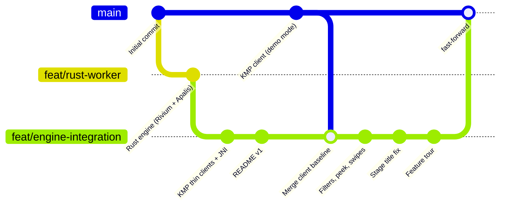

| Branch | What it holds | Runs on its own? |
|---|---|---|
| `feat/rust-worker` | The Rust engine only: Rivium app, Apalis `ScanRepo` / `CleanupScan`, loopback API, test scripts | ✅ `cargo run` on the laptop, driven with curl |
| `feat/engine-integration` | Engine + KMP clients wired through JNI: notification controls, share in/out, filters, code peek | ✅ Android and desktop with the real engine |
| `main` | Started as the client in demo mode (`FakeRadarApi`, no native library); now fast-forwarded to the integrated app | ✅ everything |

<sub>Without the native library (e.g. building only the client), `NativeEngine.createOrDemo` falls back to `DemoEngine`, so the UI is always explorable.</sub>

## 🚀 Run it

### 0. Prerequisites
- Rust ≥ 1.92; for Android: `rustup target add aarch64-linux-android`, `cargo install cargo-ndk`, NDK 30 in `ANDROID_NDK_HOME`
- JDK 17+, Android SDK
- For sign-in: a **GitHub OAuth App** with **Enable Device Flow** ticked. Its client id is public.

### 1. Laptop (no phone)

Start the engine (Rivium process host) with a dev API token and, optionally, your `gh` token so you can skip sign-in:

<details open>
<summary><b>macOS / Linux (bash, zsh) · Git Bash on Windows</b></summary>

```bash
cd rust
cargo test -p radar-core
TODO_RADAR_API_TOKEN=dev TODO_RADAR_GITHUB_TOKEN=$(gh auth token) \
  cargo run -p radar-core -- --root dev-root
```
In a second terminal:
```bash
curl -H "X-Radar-Token: dev" -X POST localhost:8737/scans \
     -H 'content-type: application/json' -d '{"owner":"tokio-rs","repo":"axum"}'
curl -H "X-Radar-Token: dev" localhost:8737/scans/1/report
```
Full checks: `bash scripts/e2e.sh tokio-rs axum` · `bash scripts/recovery.sh nushell nushell download`
</details>

<details>
<summary><b>Windows PowerShell</b></summary>

```powershell
cd rust
cargo test -p radar-core
$env:TODO_RADAR_API_TOKEN = "dev"
$env:TODO_RADAR_GITHUB_TOKEN = (gh auth token)
cargo run -p radar-core -- --root dev-root
```
In a second PowerShell window:
```powershell
$h = @{ "X-Radar-Token" = "dev" }
Invoke-RestMethod -Method Post -Uri http://localhost:8737/scans -Headers $h `
  -ContentType "application/json" -Body '{"owner":"tokio-rs","repo":"axum"}'
Invoke-RestMethod -Uri http://localhost:8737/scans/1/report -Headers $h
```
<sub>Using curl instead? Call <code>curl.exe</code> (in PowerShell, <code>curl</code> is an alias for <code>Invoke-WebRequest</code>).</sub>
</details>

<details>
<summary><b>Windows Command Prompt (cmd)</b></summary>

```bat
cd rust
cargo test -p radar-core
set TODO_RADAR_API_TOKEN=dev
for /f "delims=" %t in ('gh auth token') do set TODO_RADAR_GITHUB_TOKEN=%t
cargo run -p radar-core -- --root dev-root
```
In a second window:
```bat
curl -H "X-Radar-Token: dev" -X POST localhost:8737/scans -H "content-type: application/json" -d "{\"owner\":\"tokio-rs\",\"repo\":\"axum\"}"
curl -H "X-Radar-Token: dev" localhost:8737/scans/1/report
```
<sub>Inside a <code>.bat</code> file, write <code>%%t</code> instead of <code>%t</code>.</sub>
</details>

| Config key (`--set`, `TODO_RADAR_*`, or `<root>/todo-radar.toml`) | Default | Meaning |
|---|---|---|
| `port` | 8737 (clients pick a free one) | Loopback port |
| `api_token` | "" | Required `X-Radar-Token` |
| `github_client_id` | "" | OAuth App with Device Flow |
| `github_token` | "" | Pre-issued token (dev: `gh auth token`) |
| `max_repo_mb` / `warn_repo_mb` | 1024 / 100 | Hard cap / "Large" badge |
| `max_todos` · `keep_scans` · `cleanup_delay_secs` | 5000 · 5 · 600 | Limits and default-delete delay |

<sub><b>Troubleshooting:</b> exit code <code>73</code> means another engine already owns that <code>--root</code> (one Rivium host per data folder): stop it, or pass a different <code>--root</code>.</sub><br/>
<sub>Any key can also be passed on the command line on every OS, e.g. <code>cargo run -p radar-core -- --root dev-root --set api_token=dev --set port=9000</code>.</sub>

### 2. Desktop

Build the engine as a JNI library, then run the Compose desktop app (it embeds the engine, so there is nothing else to start).

<details open>
<summary><b>macOS / Linux · Git Bash</b></summary>

```bash
bash scripts/build-desktop.sh
cd client
TODO_RADAR_GITHUB_CLIENT_ID=<id> ./gradlew :desktopApp:run
# or skip sign-in:
TODO_RADAR_GITHUB_TOKEN=$(gh auth token) ./gradlew :desktopApp:run
```
</details>

<details>
<summary><b>Windows PowerShell</b></summary>

```powershell
cd rust; cargo build -p radar-jni --release; cd ..
cd client
$env:TODO_RADAR_GITHUB_CLIENT_ID = "<id>"
# or skip sign-in:  $env:TODO_RADAR_GITHUB_TOKEN = (gh auth token)
.\gradlew.bat :desktopApp:run
```
</details>

<details>
<summary><b>Windows Command Prompt (cmd)</b></summary>

```bat
cd rust && cargo build -p radar-jni --release && cd ..
cd client
set TODO_RADAR_GITHUB_CLIENT_ID=<id>
rem or skip sign-in:
for /f "delims=" %t in ('gh auth token') do set TODO_RADAR_GITHUB_TOKEN=%t
gradlew.bat :desktopApp:run
```
</details>

<sub><code>:desktopApp:run</code> loads <code>rust/target/release/radar_jni.dll</code> (<code>.so</code> / <code>.dylib</code>) directly. <code>scripts/build-desktop.sh</code> also copies it into <code>desktopApp/resources/</code> for packaged builds.</sub>

### 3. Android (real phone, arm64)

<details open>
<summary><b>macOS / Linux · Git Bash</b></summary>

```bash
export ANDROID_NDK_HOME=/path/to/android-sdk/ndk/30.0.16248370
bash scripts/build-android.sh
cd client && ./gradlew :androidApp:installDebug -PtodoRadar.githubClientId=<id>
```
</details>

<details>
<summary><b>Windows PowerShell</b></summary>

```powershell
$env:ANDROID_NDK_HOME = "C:\android-sdk\ndk\30.0.16248370"
cd rust
cargo ndk -t arm64-v8a -P 26 -o ..\client\androidApp\src\main\jniLibs build -p radar-jni --release
cd ..\client
.\gradlew.bat :androidApp:installDebug -PtodoRadar.githubClientId=<id>
```
</details>

<details>
<summary><b>Windows Command Prompt (cmd)</b></summary>

```bat
set ANDROID_NDK_HOME=C:\android-sdk\ndk\30.0.16248370
cd rust
cargo ndk -t arm64-v8a -P 26 -o ..\client\androidApp\src\main\jniLibs build -p radar-jni --release
cd ..\client
gradlew.bat :androidApp:installDebug -PtodoRadar.githubClientId=<id>
```
</details>

## 🔌 Engine API

| Method | Path | Purpose |
|---|---|---|
| GET | `/health` | Liveness (no token); Rivium adds `/livez`, `/readyz` |
| POST | `/auth/device` · GET `/auth/status` · POST `/auth/logout` | Device Flow; a background poller completes sign-in |
| GET | `/repos?q=` | Your repos or GitHub search, with `large` / `too_large` |
| POST | `/scans` | `{owner, repo}` or `{zip_path}` → queues `ScanRepo` |
| GET | `/scans?active=1` · `/scans/{id}` · `/scans/{id}/todos?filter=new` | Progress and results, with GitHub and github.dev deep links |
| GET | `/scans/{id}/peek?path=&line=&context=` | Code around a TODO (zip, or GitHub at the scanned sha) |
| GET | `/scans/{id}/report` | Markdown report |
| POST | `/scans/{id}/keep` · `/scans/{id}/cleanup` | Keep download · Delete now |

## 🔬 Findings for the Rivium & Apalis maintainers

| # | Finding | What we did |
|---|---|---|
| 1 | `App::services()` runs **before** the Tokio runtime exists, so sqlx `connect_lazy` panics (*"requires a Tokio context"*) | Open the pool lazily inside a service (`Db::ready`, `OnceCell`) |
| 2 | `apalis-sqlite` **fetches on its heartbeat**: with the default 30 s, new jobs waited about 30 s | `heartbeat_interval(2s)` + `missed_heartbeats(5)` |
| 3 | Orphans are re-enqueued only for workers with a **different name**; restarting `WorkerBuilder::new("scan")` left tasks locked forever | Unique worker names per Rivium generation (`scan-<millis>`) |
| 4 | `SqliteStorage::setup` sets `PRAGMA synchronous = OFF`, so jobs can be lost on power loss | Force `synchronous = NORMAL` (WAL) on our connections |
| 5 | apalis-sqlite owns `_sqlx_migrations`; a second `Migrator` conflicts | App tables use idempotent `CREATE TABLE IF NOT EXISTS` |
| 6 | reqwest 0.13's default TLS is `aws-lc-rs` (CMake/NASM to cross-compile) + `rustls-platform-verifier` (extra Android JNI init) | `rustls-no-provider` + `ring` + `webpki-roots`; clean `cargo-ndk` build |
| 7 | `rivium-http` replaces 4xx/5xx bodies with a safe envelope (a good default) | 4xx opt out with `NoEnvelope`; 5xx are logged and keep it |
| 8 | `--set key=value` makes `nativeStart` args a clean config channel; secrets never touch disk | Per-launch API token, port and client id go through it |
| 9 | GitHub's repo `size` counts history (nushell 70 MB vs a 6.4 MB zipball), and archives stream **without Content-Length** | Cap checked on metadata *and* streamed bytes; asymptotic progress |
| 10 | `rivium_jni` registers **static** natives on the named class | `object RadarBridge { @JvmStatic external fun … }` shared by Android and desktop (`jvmCommonMain`) |
| 11 | Rivium's logcat sink defaults to `warn`, so lifecycle logs only show in the file log on Android | Read `<filesDir>/engine/logs` via `run-as` |

## 📱 Real device report

Rivium's Android CI only checks compilation, so these runtime results are the useful part:

| Item | Result |
|---|---|
| Device | Real device, Android 13 (SDK 33), arm64-v8a |
| `libradar_jni.so` (stripped, release) | 12.4 MB · debug APK about 44 MB |
| Cold start → engine `/health` OK | 2.7–4.2 s (debug build; 6.8 s on the very first launch after install) |
| JNI load + `nativeStart` | ✅ `rivium_jni` registers natives in `JNI_OnLoad`; works under `-Xcheck:jni` |
| GitHub Device Flow | ✅ signed in, token persisted across app updates |
| Scan `nushell/nushell` | ✅ **320 TODOs** in about 2.5 s on Wi-Fi, identical to desktop for the same commit |
| Scan `helix-editor/helix` | ✅ about 2.5 s |
| Live progress notification | ✅ `Downloading · 0 KB`, 5/100, brand colour |
| Result notification **Keep** action | ✅ `keep_files = 1` in the device DB |
| Default delete of a shared zip | ✅ deleted by the delayed `CleanupScan` (`files_deleted = 1`) |
| Bugs the real device found (all fixed) | GitHub's `device_flow_disabled` surfaced as an opaque 502; a share without URI grant crashed (`SecurityException`); shared zips titled by UUID |

## 🧭 Next steps

- A "private repos" toggle (OAuth `repo` scope) and "turn this TODO into an issue"
- A Quick Settings tile "Rescan last repo" and a home-screen widget with TODO trends
- Release build size: LTO + `opt-level = "s"` for the JNI library

## License

MIT OR Apache-2.0, same as Rivium.
